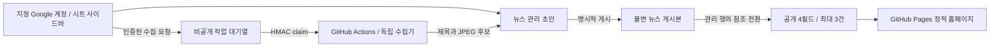

# Google Sheet 뉴스 관리

## 확정한 방향과 현재 상태

2026-10-27 사용자가 `4refund-cms` 확장을 취소하고, 지정한 기존 Google Sheet와 CMS에서
분리된 수집 서비스로 진행하도록 승인했다. 수집기는 로컬 코드·테스트까지 준비하며 가입·유료
리소스·호스팅 변경·배포는 하지 않는다. 랜딩 기준은 PR #53 병합 `26b754cc`다.

CMS 뉴스 40개 파일과 홈페이지 CMS 전용 피드 14개 파일은 해시 확인과 저장소 밖 복구본 보존 후
취소했다. CMS의 다른 작업은 건드리지 않았다. 지정 계정의 Chrome에서 정확한 문서·계정을 확인하고
`뉴스 관리` A1:Q1, `뉴스 게시본` A1:H1에 빈 헤더, 굵게·옅은 회색 배경·첫 행 고정을 적용했다.
이 초기 탭 준비 단계에는 기사나 예시를 입력하지 않았다. `상담 목록`, `leads`, `codebook`, 공유·보호·신청 경로는 그대로다.
문서 제목은 접수 준비·미연결 상태이므로 실제 운영 접수가 연결됐다고 간주하지 않는다.
Sheet ID, Script ID, 실제 서비스 URL, 이메일, 비밀값은 Git에 기록하지 않는다.

2026-10-28 사용자가 한국경비뉴스 1건과 아유경제 2건의 실제 기사 URL을 지정했다.
로컬 수집기로 세 제목과 사진을 확인했으며, 아유경제의 HTTP charset 누락은 HTML meta
인코딩 판독으로 보완했다. 아유경제 두 건은 대표 이미지 메타데이터가 없어 본문 사진 URL을
수동 선택해 같은 수집기로 검증했다. 실제 기사 데이터·JPEG·시트 등록용 초안은 저장소 밖에
보관하며 제품 코드나 개발 예시로 하드코딩하지 않는다. 지정 계정의 브라우저에서 `뉴스 관리`
A2:Q4에 세 기사와 검증된 JPEG를 초안으로 저장하고 51개 셀을 준비 데이터와 대조했다.
초안 등록 시점의 `뉴스 게시본`은 헤더만 있었다.

같은 날 사용자가 Sheet와 홈페이지의 운영 연결, 세 기사 공개, PR과 배포를 요청했다.
기존 bound script가 없음을 확인한 뒤 지정 계정의 뉴스 관리 프로젝트와 별도 읽기 전용 공개
프로젝트를 만들고 검토한 bundle·manifest·문서 참조 속성을 저장했다. 관리에는 허용 편집 계정만,
공개에는 문서 참조만 설정하며 수집 URL·토큰은 설정하지 않았다. 사용자가 두 앱의 권한과 게시
카드 익명 공개를 승인했고 Google 승인 완료 화면을 확인했다.

### 2026-10-28 실제 연결 검증

- 공개 앱 버전 3을 소유자 실행·익명 GET으로 배포했다. `SpreadsheetApp.openById`는 쓰기 scope를
  요구하므로 공개 읽기를 고급 Sheets API v4로 교체했다. 권한은 `spreadsheets.readonly`만 유지한다.
- 게시 전 익명 GET은 `articles: []`였다. 지정한 세 기사를 관리 함수의 권한·etag·ScriptLock 검증을
  통해 게시하고, 관리 3행과 불변 게시본 3행을 시트 UI에서 다시 읽었다. 실행 순서는 오래된 기사부터
  적용했으며 실제 최초 게시시각으로 사용자 지정 목록 순서가 되었다.
- 관리 사이드바의 Google 문서 프레임이 브라우저 제어 중 로딩 정지 상태여서 메뉴 이후 편집 화면의
  실제 검증은 미완료다. 이번 게시는 세 ID·URL·상태를 확인하는 일회성 실행문에서 기존 `newsList`와
  `newsMutate`를 호출했다. 완료 후 실행문을 제거하고 관리 bundle 원본을 다시 저장했다.
- 공개 GET은 HTTP 200, CORS `*`, 210,116바이트 JSON, 기사 3건을 반환했다. 각 카드의 필드는
  `id/title/url/imageUrl` 네 개이며 세 JPEG를 검증된 로컬 수집 결과와 대조했다.
  허용되지 않은 `view` 요청은 상세 정보 없는 `NEWS_UNAVAILABLE`을 반환했다.
- 실제 공개 URL을 로컬 홈페이지에 연결해 375·768·1280·1920px에서 3개 링크·사진 로드와 가로 넘침
  없음을 확인했다. 작은 화면 1열, 태블릿 2열, 데스크톱 3열이며 긴 제목은 기존 2줄 말줄임 정책을 따른다.
  이는 모의 피드 검사가 아닌 실제 Google 공개 GET 검증이며, 운영 홈페이지 배포 성공을 의미하지 않는다.
- GitHub 저장소 변수 `NEWS_PUBLIC_API_URL`을 설정하고 읽어 확인했다. 기존 견적 endpoint secret은
  변경하지 않았다. `QUICK_ESTIMATE_EMBED_SERVER_READY`와 견적 v2 운영 검증 기록은 확인되지 않았고,
  사용자는 기록 위치를 모른다고 답했다. 따라서 홈페이지 `Embed release` 실행 조건은 미충족이다.
- 이번 실행의 `npm run check`는 Node 검사 27개, Vitest 339개, Python 46개, E2E 45개 통과,
  실제 접수 E2E 5개 비활성화 결과다. 새 읽기 전용 회귀 검사는 기존 SpreadsheetApp bundle에서 실패함을
  확인한 뒤 수정했다. 원격 CI 결과와 실제 접수·알림·수집기 운영 성공으로 확대 해석하지 않는다.

증적은 저장소 밖 작업 산출물의 `news/articles-20261028/`에 보존한다. 대표 파일은
`readonly-release-check.log`, `sheet-published-A1-Q4.tsv`, `sheet-published-snapshots-A1-H5.tsv`,
`public-feed-published.json`, `live-feed-layouts.json`, `live-feed-mobile-375.jpg`,
`live-feed-tablet-768.jpg`, `live-feed-desktop-1280.jpg`, `live-feed-desktop-1920.jpg`다.

### 2026-10-28 자동 수집 활성화와 실제 저장·게시 확인

앞 절은 최초 연결 시점의 기록이다. 이후 사용자 승인으로 관리 앱의 서명 인증 웹 배포와
GitHub Actions 연결을 활성화했다. 구현 PR #58은 main `f49fbd3`에 병합됐다. 아래 검증은
`codex/news-collection-activation`의 `02e8455`에서 실행했으며 두 커밋의 파일 트리는 같다.

- 기존 기사 3건의 재수집은 Actions 실행 `40652307095`에서 성공했다. 수집 후에도 기사 ID·URL,
  편집 제목·이미지, 게시 상태, 최초 게시일, 게시본 참조가 모두 이전과 같았다. 기존 불변 게시본
  3건도 전체 TSV가 일치했다. 후보·경고·수집 시각·버전 등 수집 관련 값만 갱신됐다.
- 한국경비뉴스는 제목·이미지 후보와 `SOURCE_CHANGED` 경고를 반환했다. 아유경제 2건은
  제목 후보와 `IMAGE_MISSING`을 반환했다. 두 기사의 기존 수동 선택 이미지는 보존됐다.
  대표 이미지 메타데이터가 없는 사이트의 본문 사진까지 자동 선택하는 기능은 아니다.
- 사용자 Chrome에서 직접 연 사이드바는 정상 동작했다. 이전의 미저장 `[미저장 검증]` 문구를
  없애고 관리 행·게시본·공개 응답에 해당 문구가 없음을 확인했다. 자동화로 새로 연 Google
  프레임이 빈 화면이 되는 현상은 별개로 남아 있으며 제품 입력 화면의 정상 표시와 구분한다.
- 첫 기사에 현재 편집 제목과 저장 이미지를 유지한 채 `편집본 저장`을 실행했다. 버전은 5→6으로
  바뀌었고 공개 게시본 전체는 그대로였다. 다른 기사 2건도 변경되지 않았다.
- 이어서 같은 기사의 `저장하고 게시`를 한 번 실행했다. 17:02:28 KST에 새 게시본 1건이 추가되고
  관리 행 버전은 8, 게시본 참조는 새 값으로 바뀌었다. 기존 게시본 3건은 그대로이며 제목·이미지·URL과
  최초 게시일이 보존됐다. 승인된 현재 콘텐츠를 재게시했으므로 공개 카드의 내용과 순서는 동일하다.
- 게시 후 공개 GET은 HTTP 200, CORS `*`, 210,116바이트, 기사 3건과 `id/title/url/imageUrl`만
  반환했다. 각 응답을 관리 행이 가리키는 현재 게시본과 대조했다. 운영 홈페이지도 새로 불러와
  카드 3건의 제목·링크·이미지 SHA-256 일치와 이미지 3장의 로드 완료를 확인했다.
  이번에는 홈페이지 코드나 Pages release를 변경하지 않고 이미 배포된 공개 피드 연결을 검증했다.
- 이번 `npm run check`는 Node 검사 27개, Vitest 370개(45파일), Python 58개,
  E2E 46개 통과·5개 건너뜀이다. 포맷·lint·타입·의존성·주석·생성물·빌드 검사도 통과했다.
  `QUICK_ESTIMATE_LIVE_E2E=0`으로 실제 견적 접수·알림 시험을 비활성화했다.

증적은 저장소 밖 `news-final-verification-20261028/`에 보관한다. 전후 관리 행·게시본 TSV,
`recollection-comparison.json`, `publish-comparison.json`, `public-after-publish.json`,
`homepage-verification.json`, `published-sidebar-success.png`, `homepage-news-after-publish.png`,
`check.log`를 남겼다. 이 절의 운영 검증은 기존 3건 재수집과 동일 콘텐츠 저장·재게시에 한정한다.
새 네 번째 기사 등록, 숨김 후 재게시, 권한이 없는 운영 계정, 쿼터 소진·장기 예약 지연은 이번 실환경
시험에 포함하지 않았다. 해당 로컬 테스트 통과를 실제 운영 시험으로 대신하지 않는다.

## 데이터 흐름

### 2026-10-28 자동 수집 후속 구현

별도 수집 호스팅을 마련할 수 없다는 사용자 답변 이후, 기존 저장소의 GitHub Actions가 Apps Script
비공개 대기열을 읽는 방식으로 구현했다. 새 서비스 가입·상시 서버·유료 리소스는 만들지 않는다.
이 절은 코드 계약이며, 실제 활성화·시트 동작 검증은 별도 운영 기록으로 구분한다.

- 관리자의 URL 초안 생성/다시 가져오기가 큐에 등록된다. 방문자의 홈페이지 조회는 큐를 만들지 않는다.
- 서명된 작업자는 최소 작업 정보(URL·imageOnly·작업 ID·임대 키)를 받고 결과 후보만 반환한다.
- 후보 수집은 편집값·게시본·최초 게시일을 바꾸지 않는다. 수집 중 서버 편집이 바뀌면 etag 충돌로 후보를 버린다.
- 사이드바는 대기·수집 중·완료·실패·편집 충돌을 표시한다. 조회 중 입력한 미저장 제목을 보존하고,
  이미지 후보가 교체되면 다시 검토하도록 선택을 해제한다. 늦은 조회 응답은 이후 저장 결과를 덮지 않는다.
- 작업 임대는 3분, 최대 2회이며 큐는 1시간 후 실패 처리한다. 자동 게시·무한 재시도는 하지 않는다.
- HMAC SHA-256, ±5분 시각 창, 10분 nonce 보존으로 서명 재사용을 막는다. 인증 실패 응답은 고정 오류다.
- 예약은 5분 간격이지만 지연 가능성이 있고, 저장소 60일 무활동 시 비활성화될 수 있다.
  [GitHub 예약 정책](https://docs.github.com/en/actions/reference/workflows-and-actions/events-that-trigger-workflows#schedule)에 따라
  수동 Run workflow와 실패 후 다시 가져오기 경로를 운영 안내에 포함한다.

수집·관리 앱의 새 HTTP 연결과 공유 secret은 기존 읽기 전용 공개 앱과 별개다. 승인 후 관리 앱 웹 배포와
GitHub Actions secrets/활성화 변수를 설정한다. 롤백은 활성화 변수 false와 작업자 배포 중지이며
기존 공개 피드·게시본·스키마를 변경하거나 지우지 않는다. 상세 설정은
[관리 앱 README](../../integrations/google-apps-script/news-insights/README.md#대기열-연결-순서)를 따른다.

URL로 초안을 만든 뒤 제목·이미지 후보를 가져온다. 실패해도 초안은 남고 재시도할 수 있다.
후보 제목 채택, 직접 제목 입력, 다른 대표 이미지 URL 수집, 이미지 제거, 카드 미리보기를 지원한다.
다시 가져오기는 편집값·게시본을 덮지 않는다. 편집본 저장도 공개 상태를 바꾸지 않으며
`저장하고 게시`에서만 새 게시본을 연결한다. 숨김·재게시에서도 최초 게시일을 유지한다.
공개 목록은 최초 게시시각 내림차순 최대 3건이다. 홈페이지 방문 때 원문을 수집하지 않는다.

원문 URL과 확인된 최종 URL 중복을 차단한다. 서로 다른 쿼리 별칭까지 같은 기사로 추정하지 않으며
OG canonical도 임의로 신뢰하지 않는다. 제목·이미지 지문이 바뀌면 원문 변경 경고를 표시한다.
광고·본문 전체의 모든 변경을 감지하는 기능은 아니다.

## 저장·동시성

[모델 원본](../../integrations/google-apps-script/news-insights/src/model.ts)의 헤더 상수가 열 순서의 기준이다.
`뉴스 관리` 17열은 편집값·후보·상태·버전·게시본 ID를, `뉴스 게시본` 8열은 불변 공개 스냅샷을 저장한다.
두 탭은 비공개다. 숨긴 탭을 접근 제어 수단으로 간주하거나 시트를 공개 CSV로 배포하지 않는다.

ScriptLock과 행 전체 SHA-256 etag로 동시 편집을 검사한다. 외부 수집은 잠금 밖에서 실행하고
저장 직전에 etag를 다시 확인한다. 게시본을 먼저 추가하고 관리 행의 참조를 마지막에 setValues로
전환한다. 중간 실패면 기존 공개 게시본이 유지된다. 고아 게시본은 공개하지 않고 자동 삭제하지 않는다.
응답 손실 뒤에는 목록 새로고침으로 상태를 확인한다. mutation은 자동 재시도하지 않는다.

외부 제목은 텍스트 형식·선행 apostrophe로 기록해 수식 주입을 막고 표시값으로 읽는다.
데이터 행에 수식이 있으면 실패하며 헤더·ID·상태·날짜·이미지를 검증한다. 직접 셀 편집은 잠금을
따르지 않으므로 일상 작업은 사이드바를 사용한다. 관리 100건·불변 게시본 300개가 한도이며
초과 시 저장을 거절한다. 실제 Apps Script 메모리·실행시간·쿼터는 운영 연결 전 별도 확인한다.

## 수집 경계

[독립 수집기](../../services/news-extractor/README.md)는 Sheet/CMS 자격 증명 없이 실행한다.
기존 개발용 POST /extract와 일회성 큐 작업자가 같은 수집 함수를 사용한다. 공개 HTTP(S) 기본 포트, 모든 DNS 응답의 공개 주소 여부, IP 소켓 고정,
원래 호스트의 TLS 인증, 매 리다이렉트 재검증을 적용한다. 사설·로컬·메타데이터·IPv4 매핑/전환 주소를
차단한다. 환경 프록시와 외부 인증은 전달하지 않는다.

HTML 1 MiB, 이미지 원본 4 MiB, 압축/해제 양쪽 크기 제한, 수집 자식 프로세스 전체 20초 제한이다.
JPEG/PNG/WebP 단일 프레임, 1,200만 화소 이하만 디코드하고 최대 820×550 JPEG로 EXIF를 제거해
재인코딩한다. 70 KiB 초과는 거절한다. JPEG base64는 48,000자씩 두 셀에 저장한다.
공개 data URL로 전달하므로 방문자가 원문 이미지 서버에 접속하지 않는다. 이미지 실패는 기본 이미지로 표시한다.

[UrlFetchApp](https://developers.google.com/apps-script/reference/url-fetch/url-fetch-app)은 DNS에
소켓을 고정하거나 스트리밍 크기를 제한하는 API가 없다. 따라서 임의 기사 URL을 직접 요청하지 않고,
기존 직접 수집 모드에서만 운영자가 설정한 고정 HTTPS 수집 엔드포인트를 호출한다. 이 호출도 리다이렉트를 따라가지 않는다.
대기열 모드에서는 Apps Script가 기사 서버를 호출하지 않고 GitHub 작업자가 수집한다.
수집 엔드포인트의 신뢰성과 HTTPS는 운영 설정 조건이다.

## 권한과 공개 공급

CMS 역할을 Google 역할로 자동 치환하지 않는다. NEWS_EDITOR_EMAILS에 명시된 계정,
active/effective 사용자 일치, 현재 문서 ID 일치를 모두 요구한다. 이메일을 확인할 수 없으면 거절한다.
Google Sheet 편집자는 원시 셀과 bound script에 접근할 수 있으므로 이 기능이 악의적인 문서 편집자를
격리하는 경계는 아니다. 문서·스크립트 편집 권한은 신뢰하는 운영자에게만 준다. 다른 계정에 공유하지 않았다.

공개 GET은 ?view=news만 받고 id/title/url/imageUrl 네 필드만 반환한다. 임의 range·JSONP·공개 쓰기
API는 없다. 오류도 관리 데이터·문서 ID·stack을 포함하지 않는다. 홈페이지는 NEXT_PUBLIC_NEWS_API_URL이
없으면 숨기고, 실패면 재시도 UI를 표시한다. Google ContentService의
[리다이렉트](https://developers.google.com/apps-script/guides/content#redirects)를 허용하되 최종
Google 호스트·JSON·384 KiB 응답·8초 제한·필드 allowlist를 검사한다.

## 운영 유지와 남은 검증

1. 현재 대기열 모드의 관리 앱 웹 배포와 GitHub Actions secret 연결은 위 활성화 기록에서 검증했다.
   다른 환경에 설치할 때는 같은 연결을 다시 확인한다. 로컬 127.0.0.1 서비스는 Google에서 접근할 수 없다.
2. 신규 뉴스 전용 bound 프로젝트는 관리 bundle의 onOpen wrapper로 메뉴를 연다. 기존 bound script가
   있는 다른 환경에 설치할 때는 먼저 충돌을 확인한다. 기존 신청 파일·manifest·배포를 덮어쓰지 않는다.
3. 공개 읽기는 별도의 `news-public` bundle과 고급 Sheets API를 유지한다. 기존 신청 doPost는 복사하지 않고
   NEWS_SPREADSHEET_ID만 설정한다. OAuth는 spreadsheets.readonly이며 관리 계정·수집 토큰·쓰기 코드를 넣지 않는다.
   ScriptLock은 프로젝트별이지만 게시본이 불변이고 참조가 마지막에 바뀌므로 미완료 게시본은 선택하지 않는다.
4. 이후 OAuth 확장과 익명 공개 범위 변경도 실행 시 확인한다. 관리 앱의 익명 POST는 HMAC 후보 큐만 제공하며
   관리 RPC에는 기존 계정 인증을 유지한다. 별도 공개 앱은 소유자 실행·익명 GET을 사용한다. GitHub Actions의 NEWS_PUBLIC_API_URL 변수를
   홈페이지 빌드의 NEXT_PUBLIC_NEWS_API_URL로 전달하며 실제 URL은 Git에 기록하지 않는다.
5. 지정 계정의 사이드바 저장·동일 콘텐츠 재게시, 운영 재수집, 공개 GET·CORS·홈페이지 이미지는 위
   활성화 기록의 범위에서 확인했다. 숨김 후 재게시·새 기사 등록과 Google 쿼터 소진·장기 예약 동작은
   별도 운영 검증 대상이다.
6. 홈페이지 공개는 기존 견적 v2 운영 전환 조건을 충족한 뒤 수동 release로 수행한다.
   뉴스 연결만으로 견적 접수·migration·알림 조건이 완료되지는 않는다.

로컬 구현과 모의 테스트, 실제 초안 저장을 운영 게시 성공과 구분한다. 기존 견적의 조회·재조회에서
전송하지 않는 계약을 유지하며 실제 신청·알림 E2E는 비활성화한다.
