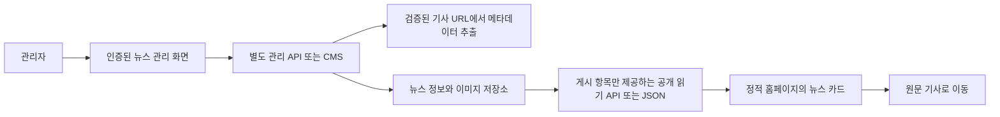

# 4refund 랜딩페이지 변경점과 뉴스 인사이트 관리 기획

센터 소개와 전문가 강점을 최신 Figma에 맞게 개편하고, 환급 절차 아래에 뉴스·인사이트 카드 영역을 추가한다. 뉴스는 관리자가 기사 URL을 등록하면 제목과 대표 이미지를 가져와 검토·게시할 수 있도록 별도로 관리한다.

이 문서는 2026-10-27에 확인한 디자인과 구현의 차이, 사용자가 추가한 뉴스 관리 요구, 후속 설계에서 결정할 사항을 구분한다. 문서 작성은 기능 구현·개인정보 정책 변경·배포 승인을 뜻하지 않는다.

## Figma 연결 없이 작업하는 방법

후속 구현은 [오프라인 디자인 자료](../design/landing-page-2026-10/README.md)를 기준으로 진행한다. 이 자료에는 전체·섹션·상세 화면, 실제 이미지·SVG 원본, 치수·색상·타이포그래피·문구·크롭·모션과 에셋 사용 위치가 포함되어 있다. Figma 링크와 노드 ID는 출처 식별용이며 다시 연결해야 읽을 수 있는 명세가 아니다.

1. 이 문서에서 변경 범위·뉴스 관리 요구·D01부터 D13까지의 미결정 사항을 읽는다.
2. [오프라인 구현 명세](../design/landing-page-2026-10/IMPLEMENTATION-SPEC.md)와 [화면 모음](../design/landing-page-2026-10/index.html)으로 목표 화면을 확인한다.
3. [문구 색인](../design/landing-page-2026-10/CONTENT.md), [에셋 목록](../design/landing-page-2026-10/ASSETS.md), `reference`의 노드·이미지 슬롯·모션 자료에서 세부값을 찾는다.
4. 구현 결과는 보존한 화면과 명세에 대조한다. 미결정 사항은 사용자에게 텍스트로 확정받고 기록하며, Figma 재접속을 전제하지 않는다.

이 자료는 2026-10-27 확인본을 고정한다. 이후 새로운 디자인 변경을 별도로 요청받은 경우에만 새 기준의 확보가 필요하다. 기존 스냅샷을 임의로 덮어쓰지 않는다.

## 분석 기준과 범위

| 항목                   | 기준                                                                                                                           |
| ---------------------- | ------------------------------------------------------------------------------------------------------------------------------ |
| 분석일                 | 2026-10-27, 한국 시간                                                                                                          |
| 저장소                 | `leekwansootv-creator/4refund`, 로컬 `C:\Project\4refund`                                                                      |
| 브랜치                 | `main`                                                                                                                         |
| 기준 커밋              | `ac39eda43b519681262919caae822e4d65d8cea0`                                                                                     |
| 커밋 제목              | `Merge pull request #51 from leekwansootv-creator/codex/quick-estimate-security-readiness`                                     |
| 갱신 상태              | 사용자 요청에 따라 `git pull --ff-only origin main` 완료. 확인 시점 HEAD와 origin/main 차이 0/0                                |
| 문서 작성 전 작업 트리 | 변경 없음                                                                                                                      |
| 의존성                 | package.json·lockfile 기준 Next.js 16.4.2, React 19.2.4                                                                        |
| 실행 환경              | Node.js 22.15.0, npm 10.9.2                                                                                                    |
| 최신 Figma             | [랜딩페이지_2026-10 변경안 2163:4123](https://www.figma.com/design/ijPZL5WxrjvxbHjBp0DoQa?node-id=2163-4123), 1920 × 8324.28px |
| 확인 방식              | 노트북 Figma 데스크톱 MCP의 전체·하위 화면, 레이어·문구·치수·모션과 데스크톱 앱의 프로토타입 연결을 직접 확인                  |
| 비교 대상              | 현재 구현 코드. 공개 배포본과 이 커밋의 일치 여부는 확인하지 않음                                                              |

클라우드 Figma 연결은 재인증 오류였지만 노트북의 데스크톱 MCP로 최신 변경안을 읽었다. 기존 기준 `290:387`과 `27:373`은 노드를 찾을 수 없어 이번 분석에서 원본을 재조회하지 못했다. 저장소의 기존 기획과 같은 파일의 [랜딩페이지 404:2434](https://www.figma.com/design/ijPZL5WxrjvxbHjBp0DoQa?node-id=404-2434)를 보조로 사용했으며, 이 인접 프레임을 기존 기준 노드와 동일한 이력으로 간주하지 않는다. 폐기된 `313:1030`은 현재 구현 기준에서 제외한다.

이하 표의 변경 유형은 **현재 코드 대비 차이**다. 최신 Figma와 다르다는 사실만으로 모두 2026-10에 처음 도입된 변경이라고 단정하지 않는다.

### 요구사항의 상태

- **확인된 사실:** 기준 커밋의 코드와 최신 Figma에서 직접 확인한 내용.
- **사용자 요구:** 최신 디자인과 구현의 변경점 정리, URL로 등록하는 별도 뉴스·기사 관리 기능.
- **설계 제안:** 뉴스 등록·검토·게시 흐름, 저장 항목, 기본 정렬·예외 처리와 시스템 구성. 구현 전 구체화할 초안이다.
- **결정 필요:** 연락처·인물 정보·홍보 문구·모바일 시안·관리 시스템 위치 등 아래 결정 목록에 남긴 항목.

이번 변경은 문서와 오프라인 디자인 자료의 커밋·push·PR까지만 포함한다. 애플리케이션·Figma 수정, 기능 구현, 실제 신청, Google Apps Script·Google Sheets 운영 데이터 접근, 병합·배포, 기존 파일·산출물 정리는 포함하지 않는다.

## 핵심 변경

1. **센터 전문 인력 소개 확장:** 박진석 세무사를 구성원에 추가하고 센터장 아래에 부센터장 사진·경력 소개를 배치한다.
2. **전문가 강점 개편:** 성공 보수형 수수료 소개를 RPA·AI 분석 소개로 교체하고, 보안 설명에 SentinelOne 제품명을 명시한다.
3. **뉴스·인사이트 추가:** 환급 절차와 하단 문의 사이에 카드 3개를 표시한다. 사용자가 추가로 요청한 URL 기반 등록·게시 관리가 필요하다.
4. **전문가 영역 시각 조정:** 제목·본문 크기를 줄이고 설명이 붙은 카드와 새 이미지로 구성한다.
5. **기존 조회 계약 유지:** 흰색 hero와 사례 트랙은 이미 구현되어 있다. Figma에 남은 연락처 우선 팝업 연결은 현재 선조회 계약과 별도로 정리해야 한다.

## 섹션별 변경 전후

| 영역              | 현재 구현                                                                                    | 최신 Figma                                                                                          | 변경 유형      | 개발 영향                                                         | 근거                                                                                                                                                                                              |
| ----------------- | -------------------------------------------------------------------------------------------- | --------------------------------------------------------------------------------------------------- | -------------- | ----------------------------------------------------------------- | ------------------------------------------------------------------------------------------------------------------------------------------------------------------------------------------------- |
| 헤더              | 포리펀 로고, 메뉴 4개, 전화·무료 진단 신청. 높이 77px, 우측 영역 290px                       | 브랜드·메뉴·CTA 유지. 높이 76px, 우측 영역 약 261px                                                 | 유지·수정      | 기존 헤더 재사용, 치수·구분선 조정 검토                           | [2163:4388](https://www.figma.com/design/ijPZL5WxrjvxbHjBp0DoQa?node-id=2163-4388), [site-header.tsx](../../src/features/landing-page/components/site-header.tsx)                                 |
| Hero와 환급 사례  | 흰색 배경, 기존 제목·설명, 봉투·동전, 조회 버튼, 하단 사례 트랙. 높이 891px, 상하 여백 100px | 주요 문구·이미지 구성·사례·위치 유지. 높이도 891px                                                  | 유지           | 기존 구조·계산 진입점 재사용                                      | [2163:4124](https://www.figma.com/design/ijPZL5WxrjvxbHjBp0DoQa?node-id=2163-4124), [quick-estimate-hero.module.css](../../src/features/landing-page/components/quick-estimate-hero.module.css)   |
| 센터 구성원       | 실명 5명과 외 다수로 구성한 6칸. 실제 프로필 사진                                            | 박진석 세무사를 두 번째에 추가해 실명 6명. 외 다수는 아래 작은 문구로 이동. 목록 사진은 실루엣 형태 | 추가·이동·수정 | 구성원 데이터·사진·배치 조정                                      | [2163:4150](https://www.figma.com/design/ijPZL5WxrjvxbHjBp0DoQa?node-id=2163-4150), [center-introduction-section.tsx](../../src/features/landing-page/components/center-introduction-section.tsx) |
| 센터장과 부센터장 | 센터장 소개, 이관수 사진·경력만 표시                                                         | 센터장 / 이관수 노무사로 변경. 아래에 부센터장 / 박진석 세무사 사진·경력 추가                       | 추가·수정      | 단일 인물 소개를 두 인물 소개로 확장, 고정 높이 재검토            | [2179:30843](https://www.figma.com/design/ijPZL5WxrjvxbHjBp0DoQa?node-id=2179-30843), [landing-content.ts](../../src/features/landing-page/constants/landing-content.ts)                          |
| 서비스와 혜택     | 숨은 보험료 진단 / 노무사 직접 검토 / 최대 환급 보장 / 철저한 사후관리                       | 동일한 4개 혜택, 첫 항목이 확장된 상태                                                              | 유지           | 자동 순환·hover·키보드 동작 재사용                                | [2163:4227](https://www.figma.com/design/ijPZL5WxrjvxbHjBp0DoQa?node-id=2163-4227), [benefits-section.tsx](../../src/features/landing-page/components/benefits-section.tsx)                       |
| 전문가 강점 도입  | 제목 96px·본문 32px, pill 요약 3개                                                           | 제목 64px·본문 24px, 설명이 붙은 모서리 8px 카드. 기술 이미지와 특허 출원 중 표시                   | 수정           | 타이포그래피·카드 구조·콘텐츠·에셋 조정                           | [2163:4237](https://www.figma.com/design/ijPZL5WxrjvxbHjBp0DoQa?node-id=2163-4237), [expert-strengths-section.tsx](../../src/features/landing-page/components/expert-strengths-section.tsx)       |
| 강점 01           | 비대면 전국 상담. 제목 48px·본문 32px                                                        | 의미·이미지 구성 유지. 제목 32px·본문 24px                                                          | 유지·수정      | 기존 행 구조 재사용, 글자·간격 조정                               | [2163:4273](https://www.figma.com/design/ijPZL5WxrjvxbHjBp0DoQa?node-id=2163-4273)                                                                                                                |
| 강점 02           | 성공 보수형 수수료. 환급 성공 시 수수료, 사전 착수금·진행 비용 없음 안내                     | 국내 최초 자동화 인공지능 프로그램 구축. RPA 자동화·AI 분석 설명과 새 이미지                        | 삭제·추가      | 수수료 안내 노출을 기술 소개로 교체. 수수료 정책 변경 승인은 아님 | [2163:4283](https://www.figma.com/design/ijPZL5WxrjvxbHjBp0DoQa?node-id=2163-4283)                                                                                                                |
| 강점 03           | 100% 정보 보안, 일반적인 보안 설명                                                           | 검증된 보안 솔루션 적용. SentinelOne의 Singularity AI SIEM 명시                                     | 수정           | 제목·본문 교체, 적용 사실·공개 범위 확인                          | [2163:4293](https://www.figma.com/design/ijPZL5WxrjvxbHjBp0DoQa?node-id=2163-4293)                                                                                                                |
| 환급 절차         | 상담 및 접수 → 진단 및 분석 → 서류 안내 및 진행 → 환급 완료, 사후관리 컨설팅                 | 4단계·사후관리 설명·어두운 배경 유지                                                                | 유지           | 기존 컴포넌트 재사용                                              | [2163:4303](https://www.figma.com/design/ijPZL5WxrjvxbHjBp0DoQa?node-id=2163-4303), [refund-process-section.tsx](../../src/features/landing-page/components/refund-process-section.tsx)           |
| 뉴스와 인사이트   | 없음                                                                                         | 포리펀 뉴스와 인사이트, 최근 보도자료 3건, 이미지 없는 카드의 대체 이미지                           | 추가           | 신규 섹션·관리 기능·데이터 공급 경계 필요                         | [2163:4347](https://www.figma.com/design/ijPZL5WxrjvxbHjBp0DoQa?node-id=2163-4347), [landing-page.tsx](../../src/features/landing-page/components/landing-page.tsx)                               |
| 하단 문의         | 어두운 배경, 전화·이메일 카드                                                                | 영역·문구 유지, 상담 번호는 코드와 불일치                                                           | 유지·확인 필요 | 기존 문의 컴포넌트 재사용, 번호 확정                              | [2163:4358](https://www.figma.com/design/ijPZL5WxrjvxbHjBp0DoQa?node-id=2163-4358), [contact-section.tsx](../../src/features/landing-page/components/contact-section.tsx)                         |
| Footer            | 저작권 표기 4대보험경정청구센터. 회사 전화·팩스 구분                                         | 저작권 표기 포리펀. 회사 상호 유지. 팩스 위치 번호·링크와 글자 색상이 코드와 다름                   | 수정·확인 필요 | 문구·연락처 검토, 대비 검증                                       | [2163:4368](https://www.figma.com/design/ijPZL5WxrjvxbHjBp0DoQa?node-id=2163-4368), [site-footer.tsx](../../src/features/landing-page/components/site-footer.tsx)                                 |

### 해석할 때 주의할 기존 반영 사항

- 어두운 hero를 흰색 조회 hero로 바꾸는 작업과 환급 사례를 hero 아래로 옮기는 작업은 완료된 상태다. 신규 변경으로 다시 계산하지 않는다.
- `Hero Image`라는 하위 레이어 두 개 중 두 번째는 센터 소개다. Hero가 두 개라는 의미가 아니다.
- `Empty Text`는 공백뿐인 너비 0 요소다. 새 콘텐츠 섹션으로 취급하지 않는다.
- 새 AI 이미지에 과거 성공 보수형 수수료 레이어 이름이 남아 있다. 화면 내용과 실제 에셋을 기준으로 판단한다.
- 뉴스는 인접 프레임 `404:2434`에도 있다. 현재 코드 대비 추가 사항이지만 최초 디자인 도입 시점은 확정하지 않는다.
- `cta-banner-section`은 기존 하단 문의 영역에 대응한다. 문의 영역 삭제로 해석하지 않는다.

### 인물과 전문가 콘텐츠

구성원 순서는 이관수 노무사, 박진석 세무사, 김민한 노무사, 박설영 노무사, 김상재 노무사, 이정계 행정사다. 기존 목록의 실사진을 실루엣으로 바꿀지는 임시 이미지 여부를 확인한 뒤 결정한다.

박진석 부센터장 시안의 경력은 세무회계 제이에스피(JSP) 대표세무사, 한국세무사회 법제위원회 위원, 한국세무사회 마을세무사회 위원, 서울지방세무사회 국제협력위원, 관할세무서 국세심사위원, 선경 세무법인 총괄 세무사, 세무그룹 정율 근무 세무사다. 실제 공개 문구와 사진의 최종본을 확인해야 한다.

전문가 요약 카드의 제목은 비대면 전국 상담, RPA 자동화 + AI 분석, 검증된 보안 솔루션으로 바뀐다. 특허·국내 최초·보안 제품 적용 문구는 디자인에 존재한다는 사실과 실제 사업·운영 사실을 구분한다. 이 문서는 해당 사실을 검증하거나 AI·보안 솔루션 구축을 요청하지 않는다.

## 메뉴와 조회 및 상담 흐름

### 유지할 현재 제품 계약

```text
환급액 조회하기
→ 업종·직원 수 입력
→ 개인정보 없이 브라우저에서 예상액 계산·결과 표시
→ 사용자가 상세 견적 받기 선택
→ 회사명·담당자 이름·이메일·전화번호·동의 입력
→ 최종 신청에서만 전송
→ 실제 응답에 따른 접수 결과 표시
```

[QuickEstimateFlow](../../src/features/quick-estimate/components/quick-estimate-flow.client.tsx)의 조회 처리와 신청 처리는 분리되어 있다. 필수 개인정보 동의와 선택 마케팅 동의, 실패·재시도 경계는 기존 [선조회 기획](quick-estimate-result-first-flow.md)을 따른다.

메뉴는 센터 소개, 주요 서비스, 전문가 강점, 환급 절차를 유지한다. 무료 진단 신청은 현재 `#contact`로 이동한다. 최신 Figma에도 스크롤 연결이 있으며, 이를 즉시 신청 폼으로 바꾸라는 근거는 없다. 뉴스 메뉴는 최신 시안에 추가되지 않았다.

### Figma 프로토타입의 충돌

최신 hero의 조회 버튼 `2163:4136`은 클릭 시 **환급액 조회하기 클릭 후** 오버레이를 열도록 연결되어 있다. 연결 대상 `324:499` 내부의 [324:500](https://www.figma.com/design/ijPZL5WxrjvxbHjBp0DoQa?node-id=324-500)은 이름·직함·연락처를 먼저 받는 과거 담당자 입력 화면이다.

이 연결을 그대로 적용하면 최초 입력 항목과 개인정보 수집 시점이 바뀐다. 현재 선조회 계약을 유지하는 것을 기준으로 삼고, 과거 연결의 잔존 여부를 디자인에서 확인한다. 별도 제품 결정 없이 수집·동의·계산·저장 정책을 변경하지 않는다.

최신 프레임 옆의 [봉투형 팝업 2179:30520](https://www.figma.com/design/ijPZL5WxrjvxbHjBp0DoQa?node-id=2179-30520)은 우리 회사 예상 환급액은?, 봉투 이미지, 사업자라면 무료로 확인할 수 있습니다., 조회 버튼으로 구성된다. 페이지 진입 시 자동 표시인지, 특정 버튼용인지, 외부 임베드용인지는 미확정이다. 표시 시점·닫기·재노출·이후 연결을 결정하기 전에는 랜딩의 새 단계로 추가하지 않는다.

## 뉴스 인사이트 관리 요구사항

### 목적과 공개 카드

사용자가 추가한 요구는 뉴스·기사 주소를 등록하면 최신 Figma와 같은 카드로 표시하고, 이를 별도로 관리하는 것이다. 현재 저장소에는 해당 뉴스 관리 기능이 없다.

Figma에서 확인한 공개 영역은 다음과 같다.

| 항목         | 확인된 디자인                                                                          |
| ------------ | -------------------------------------------------------------------------------------- |
| 위치         | 환급 절차 다음, 하단 문의 CTA 이전                                                     |
| 제목         | 포리펀 뉴스와 인사이트                                                                 |
| 안내         | 최근 보도자료 3건만 노출합니다.                                                        |
| 구성         | 데스크톱 가로 카드 3개, 각 카드에 이미지와 제목                                        |
| 치수         | 콘텐츠 폭 1280px, 카드 간격 24px, 이미지 높이 200px, 모서리 16px, 섹션 최소 높이 640px |
| 타이포그래피 | 섹션 제목 36px, 카드 제목 18px bold, 긴 제목 말줄임                                    |
| 이미지 없음  | 포리펀 기본 이미지 사용 시안 존재                                                      |
| 예시 콘텐츠  | 3개 카드에 같은 예시 제목이 반복됨. 실제 게시할 기사 3건이 확정된 것은 아님            |

뉴스 카드는 다른 주요 섹션의 1280px 컨테이너 안쪽 45px 여백과 달리 1280px 폭을 직접 사용한다. 전체 페이지의 좌우 정렬 의도를 확인해야 한다. 카드에는 현재 요약·발행일·언론사명이 표시되지 않는다. 관리용으로 값을 저장하더라도 공개 카드에 자동으로 추가하지 않는다.

### 관리 흐름 제안

```text
관리자 로그인
→ 기사 URL 입력
→ 정보 불러오기
→ 제목·대표 이미지 확인 및 필요 시 수정
→ 홈페이지 카드 미리보기
→ 초안 저장 또는 게시
→ 게시된 항목을 홈페이지에 표시
```

| 기능               | 제안하는 동작                                                                                               |
| ------------------ | ----------------------------------------------------------------------------------------------------------- |
| URL 등록           | 기사 주소를 입력하고 제목·대표 이미지 등 메타데이터를 불러온다                                              |
| 수동 보정          | 자동 추출 실패 시 제목을 직접 입력하고 이미지를 지정한다. 이미지 없이 기본 이미지로 게시할 수도 있다        |
| 미리보기           | 실제 홈페이지 카드와 같은 비율·줄바꿈·이미지 자르기로 확인한다                                              |
| 초안과 게시        | 저장과 공개를 분리한다. 정보 불러오기 성공만으로 자동 게시하지 않는다                                       |
| 숨김과 재게시      | 공개 목록에서 제외하거나 다시 노출한다                                                                      |
| 순서 관리          | 기본은 사이트 게시 시각 내림차순을 제안한다. 기사 발행일 기준·수동 순서·상단 고정은 확정이 필요하다         |
| 정보 다시 가져오기 | 원문 메타데이터를 다시 읽고 변경 내용을 미리 보여준다. 수동 수정값을 자동으로 덮어쓰지 않는다               |
| 중복 안내          | 동일 기사 URL을 등록하면 기존 항목을 안내한다. canonical URL도 신뢰하지 않고 검증한 뒤 중복 판단에 활용한다 |

최소 공개 정보는 확정 제목, 검증된 원문 URL, 대표 이미지 또는 기본 이미지다. 원문 전체 복제, 기사 본문 편집기, 검색·카테고리·페이지네이션·내부 상세 페이지·예약 발행은 현재 확정 요구에 포함하지 않는다.

### 정보 추출과 예외 처리 제안

등록 또는 다시 가져오기 시 서버에서 원문 HTML의 Open Graph 정보를 읽는다. `og:title`, `og:image`, `og:description`, `og:site_name`, `og:url`을 추출 후보로 사용한다. 제목이 없으면 HTML 제목을 보조 후보로 삼는다. 속성의 의미는 [Open Graph 공식 명세](https://ogp.me/)를 따른다.

| 상황                     | 관리 화면 처리                      | 공개 카드 처리                                                |
| ------------------------ | ----------------------------------- | ------------------------------------------------------------- |
| 제목·이미지 추출 성공    | 값을 채우고 미리보기 제공           | 검토 후 게시한 값 표시                                        |
| 제목 없음                | 직접 입력 요청                      | 제목이 확정되지 않으면 게시하지 않음                          |
| 이미지 없음·로드 실패    | 직접 지정 또는 기본 이미지 선택     | 포리펀 기본 이미지로 대체                                     |
| 원문 접근 제한·시간 초과 | 실패 사유와 재시도·수동 입력 제공   | 기존 게시 항목은 마지막 확정값 유지                           |
| 원문 정보 변경           | 다시 가져오기 결과와 현재 값을 비교 | 관리자 적용 전에는 기존 카드 유지                             |
| 게시 항목 1개 또는 2개   | 실제 게시 개수 표시                 | 빈 예시 카드로 채우지 않는 방안 제안, 정렬은 디자인 결정 필요 |
| 게시 항목 0개            | 등록·게시 안내                      | 섹션 숨김을 제안하되 빈 상태 디자인 확정 필요                 |
| 공개 목록 조회 실패      | 운영 상태를 확인할 수 있어야 함     | 0건과 오류를 구분하고 캐시·실패 표시 정책 별도 결정           |

자동 정보 추출은 모든 언론사·블로그에서 성공한다고 보장할 수 없다. 초기 대상 기사 URL을 선정해 접근 가능 여부와 제목·이미지 품질을 검증해야 한다. 홈페이지 방문 때마다 원문을 다시 읽지 않고 등록 시 확정한 정보를 저장해 제공한다.

### 저장 항목 초안

다음은 관리와 공개 표시를 분리하기 위한 개념 모델이며 확정 DB 스키마나 API 계약은 아니다.

| 항목                                | 용도                                                |
| ----------------------------------- | --------------------------------------------------- |
| 항목 식별자                         | 수정·숨김·순서 변경 시 같은 기사를 식별             |
| 입력 URL과 검증한 원문 URL          | 출처 보존, 카드 이동, 중복 확인                     |
| 자동 추출 제목·이미지·설명·사이트명 | 불러온 결과를 검토하고 다시 가져오기 결과와 비교    |
| 최종 표시 제목·이미지               | 관리자 수정값을 보존하고 공개 카드에 제공           |
| 공개 상태                           | 초안·게시·숨김의 구분을 제안                        |
| 기사 발행일                         | 추출 가능한 경우 보관. 사이트 등록·게시 시각과 구분 |
| 등록·수정·게시 시각                 | 관리 이력과 정렬 기준 후보                          |
| 수동 순서·고정 여부                 | 기능 채택 시에만 추가                               |
| 마지막 추출 시각·상태               | 추출 실패·오래된 정보를 관리 화면에서 식별          |

원문 이동은 카드 전체 링크로 제공하는 방안을 제안한다. 같은 창·새 창 여부는 확정해야 한다. 이미지를 외부 URL로 참조할지 별도 저장소에 보관할지, 직접 업로드를 허용할지와 콘텐츠 사용 범위도 함께 결정한다.

## 뉴스 관리 시스템의 구현 조건

### 현재 정적 호스팅의 제약

[next.config.ts](../../next.config.ts)는 `output: "export"`를 사용한다. [품질 게이트의 배포 규칙](../engineering/quality-gates.md)에 따라 홈페이지는 GitHub Pages 정적 호스팅을 전제로 하며 요청 시점의 Next.js 서버 런타임이 없다.

따라서 관리자 인증, 기사 URL 추출, 저장·게시를 이 정적 사이트의 Server Action이나 동적 Route Handler만으로 처리할 수 없다. **재배포 없이 기사 추가·교체를 반영하려면 별도 관리 API와 저장소, 또는 이를 제공하는 CMS가 필요하다.** Next.js 서버 호스팅으로 전환하는 선택도 가능하지만 이번 문서에서 호스팅 변경을 확정하지 않는다.

정적 홈페이지를 유지하는 구성안은 다음과 같다.



이 구성에서 방문자는 공개 카드 데이터만 읽고, 관리용 자격 증명·초안·내부 이력은 받지 않는다. 공개 읽기 데이터의 갱신·캐시 무효화·CORS를 설계해야 한다. 클라이언트에서 읽는 방식의 로딩·검색엔진 노출 요구도 함께 판단한다. 기사 데이터를 빌드 시에만 포함하는 방식은 재배포 없는 갱신 요구를 만족하지 않는다.

기존 `4refund-cms`에 관리 메뉴를 둘지, 독립된 관리 기능이나 외부 CMS를 사용할지는 미정이다. 이번 분석에서는 해당 CMS의 코드·권한·운영 구성을 조사하지 않았으며 바로 재사용 가능하다고 전제하지 않는다. 견적 접수용 Google Apps Script·Sheets를 뉴스 저장소로 사용한다는 결정도 하지 않는다.

### 외부 URL과 관리 권한의 설계 조건

외부 URL을 서버가 읽는 기능에는 URL 검증과 외부 요청 제한이 필요하다. 구현 설계에서는 HTTP(S)와 공개 목적지만 허용하고, 로컬·사설·메타데이터 주소로의 접근과 리다이렉트 우회를 차단해야 한다. DNS 검증과 실제 연결 대상이 달라지는 경우도 고려한다. [OWASP SSRF 방지 지침](https://cheatsheetseries.owasp.org/cheatsheets/Server_Side_Request_Forgery_Prevention_Cheat_Sheet.html)을 설계 근거로 사용한다.

구현 시에는 원문·이미지 요청의 시간·크기 제한, 추출 요청 빈도 제한, 이미지 형식 검증, 관리자 쓰기 권한, 미리보기 접근 권한, 외부 문자열의 안전한 렌더링을 포함한다. 수집한 HTML이나 스크립트를 그대로 홈페이지에 삽입하지 않는다. 구체적인 서비스·인증 방식·제한값은 관리 시스템 선택 후 정한다.

## 컴포넌트와 에셋 영향

| 구분           | 대상과 영향                                                                                                                             |
| -------------- | --------------------------------------------------------------------------------------------------------------------------------------- |
| 재사용 가능    | SiteHeader, QuickEstimateHeroSection, RefundCasesTrack, BenefitsSection, RefundProcessSection, ContactSection, 기존 견적 계산·신청 흐름 |
| 구조 변경      | CenterIntroductionSection의 두 인물 소개, ExpertStrengthsSection의 설명 카드와 콘텐츠, LandingPage의 뉴스 섹션 삽입                     |
| 데이터 조정    | landing-content.ts의 구성원·직함·경력·전문가 강점·저작권 문구. landing-contact.ts는 확정 연락처만 반영                                  |
| 신규 에셋      | 부센터장 사진, 전문가 도입 이미지, AI 이미지, 뉴스 기본 이미지·실제 기사 이미지                                                         |
| 신규 기능 경계 | 뉴스 등록·추출·게시·공개 조회. 현재 정적 콘텐츠 상수와 별도로 소유 기능을 설계                                                          |
| 공유 기능 영향 | 봉투 표현은 홈페이지와 외부 견적 임베드가 공유하므로 별도 팝업 변경 시 양쪽 영향 확인                                                   |
| 반응형         | 인물 소개·경력의 세로 배치, 뉴스 3열 축소 방식, 긴 제목, 팝업 높이·스크롤                                                               |
| 접근성         | 제목 계층, 인물 대체 텍스트, 카드 링크 이름·포커스, 터치 영역, 팝업 포커스 복귀, Footer 대비                                            |
| 모션           | 기존 hover·선택·자동 순환·재진입 동작과 reduced motion 유지. 새 인물·뉴스의 모션은 별도 결정                                            |

기능 구현 시 [아키텍처 규칙](../engineering/architecture.md)의 `app → features → shared` 방향과 feature 공개 진입점을 따른다. 소유 기능과 서버 실행 환경이 결정되기 전에는 폴더·라우트·저장소를 미리 생성하지 않는다. Next.js 코드 수정 전에는 설치된 버전의 `node_modules/next/dist/docs/`에서 관련 가이드를 읽는다.

### 반응형과 상태의 미확정 범위

메인·모바일 페이지에서 이번 랜딩 변경안에 연결된 모바일 화면은 확인하지 못했다. 모바일 페이지에서 확인한 화면은 주로 P1 업무 화면이다. 기존 모바일 헤더·touch 동작·키보드 조작을 유지하면서 신규 인물과 뉴스의 배치·빈 상태를 확정해야 한다.

최신 Figma에는 혜택의 마우스 진입·이탈, 문의 카드 hover, 조회 버튼 hover·오버레이, 메뉴 hover·섹션 스크롤 연결과 약 28.02초 모션 타임라인이 있다. 현행 코드는 혜택 1.6초 자동 순환, 절차 8초 반복, 전문가 영역 재진입 모션을 별도로 구현한다. 타임라인만으로 스크롤 트리거·재진입·일시정지 정책을 바꾸지 않는다.

## 콘텐츠와 정책 결정 목록

| ID  | 결정할 항목           | 현재 근거와 권장 처리                                                                                                   |
| --- | --------------------- | ----------------------------------------------------------------------------------------------------------------------- |
| D01 | 조회 버튼의 팝업 연결 | 최신 버튼이 과거 연락처 우선 화면에 연결됨. 현재 결과 우선 계약 유지 여부를 디자인 연결에 명확히 반영                   |
| D02 | 별도 봉투 팝업의 용도 | 노출 위치·자동 표시·닫기·재노출·다음 단계 미정. 결정 전 새 진입 단계로 추가하지 않음                                    |
| D03 | 인물 정보와 사진      | 박진석 세무사 사진·경력 최종본, 구성원 실루엣의 임시 여부 확인                                                          |
| D04 | 센터장 소속           | 코드의 서경대 공공정책센터 연구교수가 Figma에서 서경대 연구교수로 축약됨. 정확한 공개 표기 확정                         |
| D05 | 기술 홍보 문구        | 국내 최초, 특허 출원 중, RPA·AI 분석, SentinelOne 적용의 사실관계와 공개 범위 확인                                      |
| D06 | 수수료 안내의 위치    | 새 시안에서 기존 성공 보수·사전 비용 없음 안내가 빠짐. 다른 위치에 유지할지 결정. 정책 변경으로 추정하지 않음           |
| D07 | 상담 전화             | 코드·헤더는 010-2225-0555, Figma 하단은 010-2225-0005. 기존 문서에도 기록된 불일치이므로 새 번호 변경으로 분류하지 않음 |
| D08 | 회사 팩스             | 코드의 02-3462-5119·링크 없음과 달리 Figma는 02-3463-5119·전화 링크. 번호와 링크 역할 확정                              |
| D09 | 오타와 저작권 표기    | Figma의 최상의 결과와 위해를 코드의 최상의 결과를 위해로 유지하는지, 저작권 표기를 포리펀으로 바꿀지 확인               |
| D10 | 뉴스 운영 범위        | 초기 기사 3건, 등록 담당자, 지원할 기사 사이트, 링크 열기 방식, 원문 제목·이미지 사용 범위 확정                         |
| D11 | 뉴스 정렬과 게시 상태 | 최신순의 기준 시각, 수동 순서·고정, 초안·게시·숨김, 0건·1건·2건 표시 정책 확정                                          |
| D12 | 관리 시스템과 저장소  | 기존 CMS 확장·독립 관리 기능·외부 CMS 중 선택. 인증·공개 데이터 공급·이미지 저장·캐시 갱신 방식 결정                    |
| D13 | 모바일과 인터랙션     | 뉴스·인물·팝업 모바일 시안, 뉴스 hover·focus·로딩·실패 상태, 새 요소의 모션 확정                                        |

회사 대표전화 `02-3463-5119`, 상담 번호 `010-2225-0555`, 팩스 `02-3462-5119`, 이메일 `iwillceo@naver.com`이 현재 코드의 계약이다. Figma의 서로 다른 값을 확인 없이 적용하지 않는다. [landing-contact.ts](../../src/features/landing-page/constants/landing-contact.ts)를 단일 구현 기준으로 유지한다.

## 기존 문서와 현재 코드의 차이

| 항목      | 기존 문서                                                                           | 이번 비교에서 사용할 기준                                   |
| --------- | ----------------------------------------------------------------------------------- | ----------------------------------------------------------- |
| Hero 교체 | quick-estimate-ui-design-plan.md에는 어두운 hero를 교체하는 미래형 설명이 남아 있음 | 흰색 hero와 하단 사례는 이미 구현됨                         |
| Hero 높이 | 같은 문서의 과거 Figma 설명은 약 946px                                              | 현재 CSS와 최신 Figma는 891px                               |
| 진입 모션 | landing-page-implementation.md에는 페이지 로드당 한 번이라는 설명이 남아 있음       | 현재 전문가 영역은 재진입 반복을 사용                       |
| 견적 흐름 | 일부 기획의 배경 설명에 연락처 먼저 입력하는 과거 흐름이 남아 있음                  | 현재 코드는 업종·직원 수 선조회 후 상세 견적 신청           |
| 공개 배포 | 과거 선조회 PR 로드맵은 main push를 배포 경계로 설명                                | 현재 품질 게이트는 별도 수동 Embed release 공개 절차를 규정 |

과거 문서의 구현 전 설명을 최신 코드 상태로 오해하지 않는다. 후속 구현에서는 영향받는 기존 기획과 실행 계획도 실제 변경 범위에 맞춰 정합성을 맞춘다.

## 후속 작업 순서와 완료 기준

아래는 구현을 요청받았을 때의 순서다. 이번 문서·디자인 자료 PR은 아래 기능 구현 단계나 공개 배포를 실행하지 않는다.

| 단계 | 작업                    | 완료 기준                                                     |
| ---- | ----------------------- | ------------------------------------------------------------- |
| 1    | 콘텐츠·정책·모바일 결정 | 인물·연락처·기술 문구·조회 연결과 뉴스 운영 규칙 확정         |
| 2    | 뉴스 관리 구조 설계     | 관리 위치·인증·저장·외부 추출·공개 읽기·이미지·캐시 계약 확정 |
| 3    | 랜딩 시각 변경          | 센터·전문가·뉴스·Footer를 최신 시안과 비교하고 기존 흐름 보존 |
| 4    | 뉴스 등록과 공개 연결   | URL 입력부터 검토·게시·숨김·홈페이지 반영까지 검증            |
| 5    | 통합 검수               | 반응형·접근성·모션·실패 상태·기존 조회/임베드 회귀 검증       |

후속 구현의 검수 항목은 다음과 같다. 아직 구현되지 않은 기능의 테스트가 통과한 것으로 표시하지 않는다.

- [ ] 흰색 hero와 사례 트랙이 중복되지 않고 기존 환급액 조회가 동작한다.
- [ ] 인물·전문가·뉴스·Footer의 확정 문구와 에셋이 보존한 화면·오프라인 명세의 노드와 대응한다.
- [ ] URL 자동 추출의 정상·일부 누락·접근 실패·시간 초과·중복을 처리한다.
- [ ] 수동 수정값은 다시 가져오기만으로 덮어쓰이지 않는다.
- [ ] 초안·숨김 항목은 공개 데이터에 포함되지 않고 관리 작업은 권한을 검사한다.
- [ ] 게시·수정·숨김이 확정된 캐시 갱신 정책 안에서 홈페이지에 반영된다.
- [ ] 게시 0건·1건·2건·3건 이상, 긴 제목, 이미지 실패, 공개 목록 조회 실패를 구분한다.
- [ ] 카드 클릭은 검증된 원문으로 이동하며 키보드·focus·터치 조작을 제공한다.
- [ ] 외부 URL과 이미지 요청은 내부 목적지·리다이렉트 우회·과도한 응답을 차단한다.
- [ ] 375px·768px·1280px·1920px와 확대·reduced motion에서 새 영역을 확인한다.
- [ ] 조회·재조회에는 신청 POST가 없고 최종 신청에만 전송이 발생한다.
- [ ] 홈페이지·외부 임베드의 기존 견적 흐름과 접수 실패·재시도를 보존한다.
- [ ] 저장소 필수 `npm run check`를 통과하고 실제 실행 결과를 남긴다.

기준 코드 분석에서 검사 스크립트 24개, 단위 테스트 277개, E2E 36개가 통과했고 실제 저장 E2E 5개는 비활성화해 건너뛰었다. 이 결과는 기존 코드의 검사 결과이며 새로운 뉴스 기능, 최신 디자인과의 시각 일치, 운영 배포나 실제 Google 저장을 검증한 결과가 아니다.

## 2026-10-27 로컬 구현과 CMS 확장 검토

이 절은 PR #52의 보존 스냅샷 이후 작업 기록이다. 위 분석 기준과
`docs/design/landing-page-2026-10/` 원본은 변경하지 않는다.

### 시작 기준과 사용자 결정

- 원본 checkout: `C:\Project\4refund`, `codex/quick-estimate-security-readiness`,
  `3c5e0f97c04c09c88f60288e94f25c1e074aa217`. 시작 시 staged/unstaged/untracked 없음.
- fetch한 `origin/main`: `7c73b5f0d8b6dbafd4fcafb31f0386ddab0be203`.
  PR #52 자료가 포함된 최신 기준에서 `codex/landing-news-refresh` 격리 worktree를 만들었다.
- manifest: 85개 파일의 크기·SHA-256 일치. 캡처 20개·에셋 47개.
- D01은 현재 선조회 계약 유지, D02는 별도 팝업 추가 보류로 사용자 지시를 적용한다.
- D07·D08은 연락처 확인 전 `landing-contact.ts` 유지.
- 사용자는 D12에 대해 **기존 4refund-cms 확장 검토**를 선택했다.
  실제 CMS 수정·계정/권한 설정·배포 승인과 구분한다.
- 사용자는 **“저장된 시안의 인물·문구를 모두 최종본으로 승인”**했다.
  D03~06·D09에 이를 적용해 박진석 사진/경력, 구성원 실루엣, 센터장 소속,
  RPA·AI/국내 최초/특허 출원 중/SentinelOne 문구와 저작권을 반영한다.
  기존 성공 보수 행은 승인된 시안의 RPA·AI 행으로 교체한다.
  이는 사용자의 공개 콘텐츠 승인 기록이며 기술·특허 사실의 독립 검증 결과가 아니다.
- 같은 날 후속 지시로 D04의 실루엣 적용을 실제 인물 사진으로 변경했다.
  기존 5명 사진을 재사용하고 박진석은 하단 소개의 큰 원본을 원형 슬롯 안에서 크롭한다.
  부센터장 경력은 문장 중간 줄바꿈이 없도록 설명 영역 폭과 열 간격을 조정한다.
- 전문가는 다릅니다 영역은 정적 시안의 생략을 모션 삭제로 해석하지 않는다.
  기존 좌우 진입과 28.020507초 주기의 상하 20px 모션을 새 도입 이미지에 연결한다.
  새 이미지의 개별 Figma 키프레임을 발견한 것이 아니라 사용자 요청에 따라 기존 모션을
  재사용한 결정이다. reduced motion에서는 움직임을 끈다.
- 연락처는 별도 확인 지시를 따라 기존 값을 유지한다. 기존 문장 “최상의 결과를 위해”는
  보존 원문의 오탈자 표기로 되돌리지 않는다.
- D10의 실제 기사/담당자, D11·D13의 뉴스/모바일 제안과 CMS 구체 구현안은 답변 대기다.

### 독립적으로 구현하는 범위

1. 센터장/부센터장 소개를 역할·이름·직함·경력·사진을 받는 공통 행으로 분리한다.
   6명 실제 사진과 두 인물 사진/경력을 표시한다. 긴 경력과 작은 화면에는 유동 높이를 쓴다.
2. 전문가 도입은 64px 제목, 설명 카드, 282×413 기술 이미지, 24px 본문을 적용한다.
   세 강점 행은 32px 제목/24px 본문으로 조정한다. 승인된 RPA·AI 이미지/설명,
   특허 배지와 SentinelOne 보안 설명을 적용한다.
3. Footer는 최소 높이 229px와 기존 대비 조정 색을 사용하고 저작권을 포리펀으로 표기한다.
4. `news-insights`는 공개 카드의 **표시 컴포넌트와 상태 계약**만 소유한다.
   `unconfigured/loading/error/ready`를 구분하며 홈페이지는 현재 `unconfigured`다.
   실제 뉴스 조회·관리·게시가 구현됐다는 의미가 아니다.
5. 검증용 카드 데이터는 테스트와 저장소 밖 로컬 미리보기에만 둔다. 실제 기사로 게시하지 않는다.

뉴스 UI 검토안은 0건 숨김, 최대 3건, 전달받은 순서 유지, 1·2건 빈 카드 없이 표시,
새 창 링크, 1/2/3열 반응형, 로딩/실패/재시도 구분이다. 정렬과 정책의 최종 확정은
D10·D11·D13에 따른다. 밝은 회색 안내 문구와 강점 본문은 가독성을 위해 대비를 높였다.

### 기존 CMS 읽기 전용 확인과 제안

확인 경로는 `C:\Project\4refund-cms`, HEAD는
`7cf1a8ac1d8e3a664cf790c6c7db9fced9eddb87`이다.
`feat/cms-tutorial-phase1`에 여러 미커밋 변경이 있어 수정하지 않았다.
현재 파일 관찰과 운영 배포 상태는 구분한다.

- `backend/src/cms/app.py`: FastAPI 앱과 `/api/v1` 라우터 조립.
- `backend/src/cms/core/registry.py`: 도메인·인증 공급자·모델의 명시 등록.
- `backend/src/cms/identity/repository.py`, `identity/http.py`:
  DB 세션·현재 사용자 재검증과 CSRF 경계.
- `backend/src/cms/identity/policy.py`: `developer/admin/head/sales/labor` 역할.
  기존 계정 관리 권한이 뉴스 게시 권한을 자동으로 뜻하지 않는다.
- `docs/engineering/architecture.md`, `backend/pyproject.toml`:
  PostgreSQL·SQLAlchemy·Alembic 기반.
- `frontend/package.json`: 별도 Next.js 프런트엔드와 계약 생성/검사 도구.

위 구조를 근거로 기존 CMS 확장이 별도 인증/계정 시스템을 추가하는 것보다 적합하다.
다만 뉴스는 고객 업무 자료와 다른 공개 콘텐츠이므로 별도 도메인과 공개 읽기 경계를 둔다.
다음은 **구현 전 승인할 구체안**이다.

| 경계          | 제안                                                                                                                                   |
| ------------- | -------------------------------------------------------------------------------------------------------------------------------------- |
| 관리 화면     | CMS 내 뉴스 관리 메뉴. 기존 로그인 재사용, 개발자·총괄 관리자만 뉴스 편집/게시 가능하게 명시적 권한 추가. 실제 운영 담당자 지정은 별도 |
| 저장          | 기존 PostgreSQL에 뉴스 전용 테이블. 원문 URL, 추출 후보, 수동 확정값, 초안/게시/숨김, 버전, 작성/수정/게시 시각을 분리                 |
| 메타데이터    | 인증·CSRF·빈도 제한 뒤 서버가 가져옴. 재추출 결과를 후보로만 저장하고 사용자 적용 전 수동 확정값 불변                                  |
| 이미지        | 검증 후 뉴스 전용 공개 이미지 공간에 저장. 기존 고객 자료 저장 경로·권한·다운로드 API 재사용 금지                                      |
| 공개 목록     | 게시 상태만 선택한 별도 익명 GET. id/title/url/imageUrl만 투영, 최신 게시 시각 순 최대 3건. 재게시 시 게시 시각 갱신 여부 확인 필요    |
| 홈페이지 연결 | Pages 정적 export 유지. 확정한 공개 endpoint만 브라우저에서 GET, credentials omit, origin 한정 CORS, 8초 timeout, 재시도 버튼          |
| 갱신          | 공개 응답 캐시 최대 60초 제안. 게시/숨김 후 이 범위 내 새 방문에 반영, 열린 페이지 자동 갱신 여부 별도 결정                            |
| 동시 편집     | 항목 버전 검사로 덮어쓰기 충돌 안내, URL 정규화·DB 유일 제약으로 중복 등록 방지                                                        |

외부 URL 수집기는 HTTP(S) 공개 목적지만 허용하고 사용자 정보·비표준 포트·사설/로컬/
link-local/metadata/IP 변형을 거부한다. 매 리다이렉트와 DNS 결과를 검증하고 검증한 IP로
실제 연결을 고정하며 원래 hostname으로 TLS를 검증한다. 환경 proxy를 자동 사용하지 않는다.
원문과 이미지 모두 전체 시간·응답 바이트·리다이렉트 수를 제한하고, 이미지는 실제 디코딩과
크기 제한으로 검증·재인코딩한다. 외부 문자열은 텍스트로 렌더링하고 HTML/스크립트를 공개하지 않는다.
제한값과 지원 언론사 목록은 구현 설계에서 확정한다.

초안·숨김·추출 원문·등록자·감사 이력·자격 증명이 공개 응답으로 나가지 않는 서버 테스트,
권한 없는 요청/CSRF/동시 수정/중복/재추출/이미지 실패, 모의 DNS·리다이렉트 우회 테스트를
필수로 한다. 현재 이 서버 기능은 미구현이며 실제 Google·CMS DB·운영 계정에 접근하지 않았다.

CMS 수정은 이 구체안의 결정 후 별도 격리 checkout에서 진행한다. 현재 CMS의 미커밋
튜토리얼 변경을 복제·커밋·덮어쓰지 않으며, 실제 기반 branch와 통합 순서를 다시 확인한다.

## 관련 문서

- [기존 랜딩 구현 기획](landing-page-implementation.md)
- [기존 랜딩 PR 로드맵](landing-page-pr-roadmap.md)
- [기존 간단 견적 UI 기획](quick-estimate-ui-design-plan.md)
- [현재 선조회 및 상세 견적 신청 계약](quick-estimate-result-first-flow.md)
- [선조회 PR 실행 계획](quick-estimate-result-first-pr-roadmap.md)
- [외부 견적 임베드 설계](quick-estimate-embed-plan.md)
- [아키텍처 규칙](../engineering/architecture.md)
- [검사와 정적 배포 규칙](../engineering/quality-gates.md)
