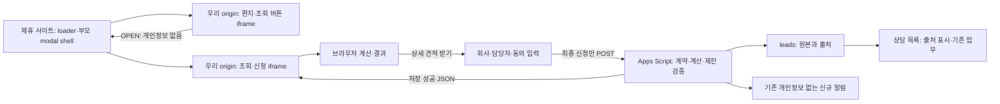

# 예상 환급액 조회 기능의 외부 사이트 삽입 모듈화 기획·기술 설계

## 문서 상태와 적용 범위

- 작성일: 2026-10-23
- 상태: 기술 기본안 작성 후 사용자가 로컬 구현·자동 테스트를 승인했다. 아래 기획 시점의 코드 설명과 마지막 로컬 구현 기록을 구분한다. 운영 변경·출시 승인을 뜻하지 않는다.
- 코드 확인 기준: `C:\Project\4refund`, `main`, `c5b468b70afff43dc13a839f791442b9f58fdf36`. 작업 시작 시 추적·미추적 변경 파일 없음.
- 최초 기획 산출물: 이 문서 한 개. 기획 단계에서는 Google 자산·운영 접수·저장소 출하를 수행하지 않았다. 이후 승인된 로컬 구현은 마지막 기록과 설치 가이드, 새 빈 Google 환경 준비는 [준비 기록](../operations/quick-estimate-miningdev8-preparation.md), 2026-10-23에 요청된 검수·저장소 출하는 GitHub PR 기록으로 구분한다. Apps Script 웹앱 배포·실제 접수·알림·홈페이지 접수 주소 전환·Pages 공개는 별도 승인 단계다.
- 외형 재설계는 제외한다. 현재 편지·동전·버튼·모달·입력·결과·동의 화면을 유지하며, 삽입 컨테이너 크기와 모달의 표시·포커스·스크롤 경계만 기능적으로 분리한다.

**권장안은 우리가 배포하는 작은 삽입 스크립트와 우리가 호스팅하는 iframe을 조합하는 방식이다.** 외부 개발자는 삽입 코드만 적용한다. 편지 영역과 조회·신청 UI는 우리 origin 안에서 실행하고, 최종 상담 신청만 기존 Apps Script와 Google 시트로 모은다. 부모 페이지에서 관측한 설치 origin을 제출에 포함하고 Apps Script가 도메인으로 정규화해 신규 컬럼에 저장한다.

정적 자원 제공은 현재 GitHub Pages 구조로 기술적으로 시작할 수 있다. 버전별 자원 보존과 iframe 제공 헤더 확인은 추가해야 한다. 호스팅 이용 조건, 강제적인 허용 사이트 제한, 응답 헤더 제어가 필요하면 같은 정적 결과물을 별도 정적 호스트로 옮기는 조건부 대안을 둔다. 새 DB나 Next.js 서버 도입은 기본안에 포함하지 않는다.

목표는 공통 모듈을 준비하고 제휴 홈페이지 개발자에게 “이 코드를 넣으면 이 기능을 사용할 수 있다”고 전달할 수 있는 상태다. 실제 제휴처나 캠페인 결정은 공통 설계·구현의 선행 조건이 아니다. 최초 요청에서는 기획만 수행했으며, 후속 승인에 따른 로컬 구현·검증 결과는 마지막 기록에 정리한다. 로컬 구현 완료와 운영 제공 가능 상태를 구분한다.

## 요구사항 원문과 관련 문서

첫 번째 Obsidian 경로인 `C:\Users\misom\OneDrive\문서\Obsidian Vault\Opsidian\프로젝트\4대보험\4refund 홈페이지 변경사양.md`는 없었다. 대체 경로인 `C:\Users\user\OneDrive\문서\Obsidian Vault\Opsidian\프로젝트\4대보험\4refund 홈페이지 변경사양.md`에서 다음 부분을 확인했다. 원본은 수정하지 않는다.

- 회의 요약 12행: 네이버 이벤트 등 출처별 효과를 구분하려는 목적.
- `5-예상 환급액 조회 모듈화` 50~58행: 여러 홈페이지에 편지 영역부터 버튼·모달까지 노출, 우리가 관리하는 배포 방식, 사이트 도메인의 신규 컬럼 저장 제안.

센터 구성원 추가, 인물 소개, 강점 문구, 특허 이미지, 보안 솔루션 홍보는 반영하지 않는다. 원문의 CDN은 제공 방식의 예시다. 소스를 제공하지 않는다는 말은 저장소와 유지보수 책임을 제휴사에 넘기지 않는다는 뜻이며, 브라우저에 전달한 JavaScript를 비공개로 만들 수 있다는 뜻이 아니다.

동일 목적의 기존 삽입 기획 문서는 발견하지 못했다. 다음 문서를 대체하지 않고 외부 설치·출처 계약을 확장하는 문서로 추가한다.

| 기존 문서                                                                                                                                                                                  | 이 문서와의 관계                                                                                                        |
| ------------------------------------------------------------------------------------------------------------------------------------------------------------------------------------------ | ----------------------------------------------------------------------------------------------------------------------- |
| [엔지니어링 규칙](../engineering/README.md), [아키텍처](../engineering/architecture.md), [코드 컨벤션](../engineering/code-conventions.md), [품질 게이트](../engineering/quality-gates.md) | 폴더·의존성·주석·검사 기준을 유지한다.                                                                                  |
| [선조회 플로우](quick-estimate-result-first-flow.md)                                                                                                                                       | 개인정보 없는 조회, 최종 신청, 실패·재시도 정책을 유지한다. 외부 모달 shell과 출처만 추가한다.                          |
| [계산·제출 기술 설계](quick-estimate-technical-design.md)                                                                                                                                  | 계산·응답 계약은 유지한다. 기존 24열 뒤의 출처 확장과 두 요청 버전의 공존을 제안한다.                                   |
| [상담 목록 설계](quick-estimate-consultation-queue.md)                                                                                                                                     | 기존 16열·업무값·동기화는 보존한다. 외부 출처 표시를 끝에 추가하는 변경 제안이다.                                       |
| [운영 runbook](../operations/quick-estimate-runbook.md), [Apps Script README](../../integrations/google-apps-script/quick-estimate/README.md)                                              | 후속 구현 때 migration·배포·복구·제휴 설치 절차를 함께 갱신한다. 과거 운영 기록을 현재 운영 검증으로 재사용하지 않는다. |

기존 문서의 “24개 컬럼 유지”, “별도 route 없음”, “출처 표시 제외”는 기존 기능의 기준이다. 이 문서는 그 기준의 확장을 제안할 뿐 현재 규칙을 즉시 변경하지 않는다. 구현 시 관련 문서·타입·검사·생성 artifact를 같은 변경 단위에서 정정하며 검사만 완화하지 않는다.

## 목적, 확정 요구사항과 비범위

목적은 제휴사·지인의 외부 홈페이지에서 상담 신청 기회를 늘리고, 최종 신청이 발생한 설치 사이트를 구분하는 것이다. 단순 조회 건수와 상담 신청 건수는 다르다. 출처별 신청 건수는 비교할 수 있지만 조회·방문 분모가 없으므로 이 데이터만으로 전환율이나 광고 수익성을 계산하지 않는다.

| 구분              | 내용                                                                                                                                                                               |
| ----------------- | ---------------------------------------------------------------------------------------------------------------------------------------------------------------------------------- |
| 확정 요구사항     | 현재 편지 모양 진입 영역·조회 버튼·모달·조회·상담 신청 흐름을 외부에서 사용한다. 디자인 변경은 하지 않는다.                                                                        |
| 확정 요구사항     | 외부에는 간단한 코드 또는 URL을 제공하고 호스팅·배포·업데이트는 우리가 관리한다.                                                                                                   |
| 확정 요구사항     | 개인정보 없는 선조회, 최종 신청에서만 검증·저장, 기존 계산·표시금액·동의·재시도·성공 판정을 유지한다.                                                                              |
| 확정 요구사항     | 어느 외부 사이트에서 신청했는지 저장 시 구분한다. 기존 Google 시트로 수집하는 기본안을 검토한다.                                                                                   |
| 설계 제안         | 삽입 스크립트 + 진입 iframe + 부모 문서의 모달 안에 생성하는 조회 iframe을 사용한다.                                                                                               |
| 설계 제안         | 초기에는 도메인·origin·수집 방법·채널·요청 버전만 저장하고, 상담 목록에 설치 사이트를 표시한다.                                                                                    |
| 설계 제안         | 획득 실패는 명시적 미확인 출처로 접수한다. 형식 위반 요청은 거절하며 홈페이지 출처로 임의 대체하지 않는다.                                                                         |
| 설치·운영 시 확인 | 실제 제휴 도메인과 script·iframe 허용 조건은 제휴처가 정해질 때 확인한다. 호스팅·고지·용량 검증은 우리 측 공개 준비 작업이며 기획을 중단하고 사용자 답변을 기다리는 항목이 아니다. |

캠페인 자동 추적, 방문 이력·쿠키·광고 식별자, 분석 대시보드, 익명 조회 저장소, 제휴사별 개인정보 열람, 수수료 정산, 로그인·파일 업로드·CRM 변경은 제외한다. 추가 ID가 기술적으로 가능하다는 이유만으로 출시 범위에 넣지 않는다.

## 기획 시점 체크아웃에서 확인한 구현과 차이

다음은 저장소 코드의 사실이다. 현재 운영 Sheet의 헤더·접근권한, 실제 Web App 버전·트리거·메일 수신, 공개 사이트의 배포 SHA는 이번에 조회하지 않았다.

| 확인 항목      | 현재 코드 근거와 관측                                                                                                                                          | 외부 삽입에 필요한 변화                                                                                                       |
| -------------- | -------------------------------------------------------------------------------------------------------------------------------------------------------------- | ----------------------------------------------------------------------------------------------------------------------------- |
| 정적 배포      | `next.config.ts`: `output: "export"`, `images.unoptimized`, 빌드 시 `PAGES_BASE_PATH`. `.github/workflows/quality.yml`: verify 후 `out/`을 Pages로 배포        | 정적 embed 진입점, loader와 버전별 배포 자원 추가. 요청 처리 서버를 Next.js에 만들지 않는다.                                  |
| 루트 조합      | `src/app/page.tsx`가 랜딩과 `QuickEstimateFlow`를 조합하고 `#contact`를 전달                                                                                   | 기존 루트는 유지하고 외부 화면은 별도 route에서 조합한다.                                                                     |
| 진입 UI        | `landing-page/components/quick-estimate-hero-section.tsx`에 소개·편지/동전·CTA slot·환급 사례 트랙이 함께 있다. hero는 desktop 891px와 페이지 전용 위치를 사용 | 편지·문구·버튼 단위를 분리한다. 외부에는 전체 랜딩·소개·환급 사례 트랙을 자동 복제하지 않는다.                                |
| 조회·신청      | `quick-estimate-flow.client.tsx`: `handleLookup`은 계산·결과만 변경. `handleApply`는 입력 단계로 이동. `handleSubmit`/재시도에서만 전송                        | 조회·재조회·입력 중에는 POST·원본 행·상담 행·신규 알림 0건을 유지한다.                                                        |
| 계산           | `calculate-estimate.ts`, `estimate-rule-set.ts`: 브라우저 계산, 난수와 버전 포함. 서버도 같은 공개 feature 계약으로 재계산                                     | 산식·업종·인원 범위·표시금액은 변경하지 않는다.                                                                               |
| 전송           | `submit-estimate-lead.ts`: form encoded `payload`, credentials 생략, redirect 추적, 기본 15초, JSON의 정확한 성공 shape 확인                                   | iframe 안에서 같은 endpoint로 직접 POST한다. 부모 사이트에 연락처를 전달하지 않는다.                                          |
| 출처           | `types/lead-submission.ts`, `schemas/lead-submission.ts`, `validate-submission.ts`에서 `sourcePath: "/"` 고정                                                  | `source_path`의 의미는 유지하고 별도 계약·컬럼을 추가한다.                                                                    |
| 엄격한 계약    | Apps Script `ROOT_KEYS`와 하위 object 키가 완전 일치해야 한다. 응답도 브라우저가 완전 일치로 검사                                                              | 신규 필드는 구 서버에서 거절된다. 신 서버의 구·신 요청 지원을 먼저 배포하고 응답 shape는 바꾸지 않는다.                       |
| 저장·후속 처리 | `storage-service.ts`: Script lock 내부의 request ID 조회 → 신규 원본 쓰기 → 상담 투영. 잠금 해제 후 알림. 중복이면 신규 알림 없음                              | 출처는 최초 원본에 함께 저장하고 중복 재시도에서 수정하지 않는다. 투영·메일 실패가 원본 성공을 취소하지 않는다.               |
| 처리 순서 차이 | `web-app.ts`는 검증 → rate limit → `storeLeadSubmission` 순서다. 일부 과거 문서의 “중복 조회 후 rate limit” 그림과 다르다.                                     | 이 문서의 기준은 코드다. 저장 멱등성과 제한의 재차감 면제를 구분한다.                                                         |
| 시트·동기화    | 원본 24열, 상담 목록 16열. 상태 원본 쓰기는 23~24열, 상담 연결 ID는 16열. 재동기화는 없는 `lead_id`만 추가                                                     | 중간 삽입 금지. 신규 컬럼을 끝에 추가하고 기존 상담 행의 출처만 갱신하는 별도 보강 절차가 필요하다.                           |
| 모달·자원      | native `dialog.showModal`, 해당 문서 body scroll lock, 단계별 focus. 앱 CSS·theme·`next/font`·basePath 이미지·문의 hash에 의존                                 | 부모 document modality와 iframe 내부 UI 책임 분리. 우리 origin의 자원과 실제 문의 URL을 사용한다.                             |
| 운영 코드      | 편집 트리거, 정기 누락 행 복구·알림 실패 점검 코드가 존재                                                                                                      | 코드 존재와 실제 설치·실행 여부를 분리해 출시 때 확인한다. 정기 점검이 모든 상태 반영 실패를 자동 복구한다고 가정하지 않는다. |

원문의 “조회하면 DB에 쌓인다”는 설명은 현재 구현과 다르다. 이번 확장에서도 Google 시트에 쌓이는 것은 **최종 상담 신청 데이터**다.

## 외부 제공 방식 비교

후보는 세 가지로 한정한다. 모든 예시의 `widget.example.invalid`는 설명용 주소이며 실제 운영 도메인·endpoint가 아니다.

| 기준            | CDN 스크립트가 UI 직접 생성                                      | iframe만 삽입                                                                 | 스크립트가 iframe과 부모 모달 관리: 권장                                |
| --------------- | ---------------------------------------------------------------- | ----------------------------------------------------------------------------- | ----------------------------------------------------------------------- |
| 외부 설치       | 컨테이너 + `<script src="…/widget.js">`                          | `<iframe src="…/embed/quick-estimate.html">`                                  | 컨테이너 + `<script src="…/embed/v1/loader.js">`                        |
| 우리가 배포     | 독립 UI bundle, CSS, 이미지, 폰트                                | 정적 embed HTML과 종속 자원                                                   | 작은 loader와 정적 embed HTML·자원                                      |
| 프레임워크 독립 | standalone bundle 및 React 의존성 격리 필요                      | 가능                                                                          | 가능. 부모에 React 설치 요구 없음                                       |
| CSS·JS 충돌     | Shadow DOM 등 추가 격리가 필요하며 전역 JS·폰트·portal 영향 남음 | iframe 안의 CSS·JS는 별도 document                                            | UI는 격리. 부모의 작은 modal shell·스크롤 제어만 충돌 검증              |
| 자원 경로       | 부모 URL 기준 상대경로 오동작을 모두 방지해야 함                 | 우리 iframe origin·basePath 기준                                              | iframe 자원은 우리 origin, loader 자원도 절대 URL                       |
| 크기·모바일     | 부모 layout과 viewport가 직접 영향                               | 높이 직접 조정 또는 내부 이중 scroll                                          | 진입 크기 보고와 부모 viewport modal을 loader가 관리                    |
| 키보드·포커스   | 부모 앱과 focus trap 충돌 가능                                   | iframe 내부 modal은 부모를 막지 못함                                          | 부모 native dialog로 배경 차단, iframe으로 단계 focus 전달              |
| 모달 잘림       | body/top layer 배치하면 해결 가능하나 기존 UI 재포장 부담        | dialog는 iframe 밖으로 확장되지 않음. 높이를 크게 해도 부모 전체 modal은 아님 | 부모 top layer에 전체 viewport shell, 그 안의 iframe에서 기존 카드 표시 |
| 실패·복구       | loader 실패 시 남겨 둔 일반 링크, UI 오류 복구 필요              | iframe `load`만으로 정상 실행 판정 불가. 일반 링크 필요                       | ready timeout·버전 불일치·미지원 상태를 표시하고 재로딩/일반 링크 제공  |
| 업데이트        | widget bundle 전체의 호환성 부담                                 | URL별 문서·자원 보존 필요                                                     | loader protocol과 UI release를 함께 고정·회귀 검증                      |
| 평가            | 현 Next.js 화면을 별도 배포 형태로 재구성하는 비용이 큼          | script 금지 환경의 축소 대안                                                  | 설치 편의·현 UI 재사용·부모 modal 제어의 균형이 가장 적합               |

iframe 내부의 `showModal()`은 그 iframe document만 차단한다. 따라서 작은 편지 iframe 안에서 기존 modal을 열기만 하는 구현은 채택하지 않는다. [MDN showModal](https://developer.mozilla.org/en-US/docs/Web/API/HTMLDialogElement/showModal)

### 외부 개발자가 적용하는 코드와 설정

권장 설치 코드의 목표 형태는 다음과 같다. 그대로 동작하는 배포물이 아니라 후속 구현 계약 예시다.

```html
<div id="fourrefund-estimate">
  <a
    href="https://widget.example.invalid/embed/quick-estimate.html?mode=standalone"
    target="_blank"
    rel="noopener noreferrer"
  >
    예상 환급액 조회 페이지 열기
  </a>
</div>
<script
  defer
  src="https://widget.example.invalid/embed/v1/loader.js"
  data-target="fourrefund-estimate"
></script>
```

- 외부 개발자가 설정할 것은 컨테이너 ID, 제공받은 loader URL, 사용 가능한 가로 폭이다. 별도 npm 설치·빌드·저장소 접근·Google 자격 증명·Apps Script URL 입력은 요구하지 않는다.
- 기본 지원 폭은 320px 이상, 폭은 부모 컨테이너 안에서 100% 이하다. 442px 수준의 현재 편지 비율과 동전 돌출·그림자 영역을 포함해 높이를 계산한다. 작은 칸을 위해 글자·버튼을 무작정 축소하지 않는다. 기준 폭 미만에는 페이지 열기 안내를 제공한다.
- HTML/CMS의 script 허용, `script-src`의 loader origin 허용, `frame-src`의 UI origin 허용이 필요하다. 외부 CSP 전체에 `*` 또는 `unsafe-inline`을 요구하지 않는다. 부모 shell 스타일은 전용 stylesheet 또는 합의된 nonce 방식으로 처리하며 설치 가이드에 필요한 최소 정책을 명시한다.
- 부모의 `connect-src`에 Google endpoint를 추가하는 것이 제출 해결책은 아니다. 실제 fetch는 iframe document의 정책을 따른다. 우리 문서의 CSP를 적용할 경우 Apps Script와 redirect 목적지의 응답 읽기까지 검증한다.
- SPA는 mount마다 중복 설치하지 않도록 idempotent mount와 unmount 정리를 제공한다. 한 페이지 여러 인스턴스는 instance ID로 분리하고 동시에 하나만 모달을 연다.
- fallback 링크는 JavaScript 실행 전에도 존재하고, ready 확인 뒤 정상 영역으로 대체한다. `noscript`만으로는 차단·다운로드 실패를 처리할 수 없다.

script를 넣을 수 없는 제휴사는 다음 iframe 또는 일반 링크를 사용할 수 있다.

```html
<iframe
  src="https://widget.example.invalid/embed/quick-estimate.html?mode=inline"
  title="포리펀드 예상 환급액 조회"
  width="100%"
  height="760"
  referrerpolicy="strict-origin-when-cross-origin"
></iframe>
<a
  href="https://widget.example.invalid/embed/quick-estimate.html?mode=standalone"
  target="_blank"
  rel="noopener noreferrer"
>
  넓은 화면에서 조회하기
</a>
```

이 축소 대안은 iframe 안에서만 조회·신청하고 내부 scroll을 사용한다. 부모 페이지 전체를 덮는 modal 동작은 보장하지 않는다. 그 동작까지 필수인 제휴처는 권장 script 방식이 설치 조건이다. 출처가 반드시 필요한 일반 링크 설치에는 등록한 `site_origin`을 URL에 명시해 `configured`로 처리할 수 있지만 이는 관측된 도메인이 아니라 전달값이다. 링크 공유·복사로 오인될 수 있음을 운영에 표시한다.

## 사용자 흐름과 구성 요소



1. 방문자는 현재 디자인의 편지와 `환급액 조회하기`를 본다.
2. 버튼 클릭 시 loader가 부모 문서 body의 native dialog를 열고 조회 iframe을 만든다. 이 시점에 폼 시작 시간을 기록한다. 자원 다운로드만으로 폼 체류 시간을 시작하지 않는다.
3. 조회 iframe에서 업종·직원 수 → `조회하기` → 결과를 표시한다. 계산과 난수 생성은 브라우저 안에서 수행하며 원본 저장·메일은 없다.
4. `상세 견적 받기`에서 기존 연락처 네 항목과 동의를 받는다. 입력·단계 이동은 POST하지 않는다.
5. `상세 견적 신청하기`에서 계산 결과·연락처·동의·출처를 하나의 payload로 고정해 제출한다. 재시도는 같은 ID와 payload를 사용한다.
6. 저장 성공 body를 읽은 뒤 완료를 표시한다. 완료 후 닫으면 부모 scroll 위치와 편지 iframe의 조회 버튼 focus를 복구한다.

외부 개발자는 지원 조건 확인 → 우리가 준 코드 적용 → 자신의 비운영 페이지에서 표시·모달·출처 진단 확인 → 합의한 실연동 검증 → 공개 순서로 설치한다. 진단에는 모듈 버전, 부모 origin, 식별 방법, 연결 준비 상태만 표시하며 연락처나 저장 요청을 발생시키지 않는다.

### 모달·포커스·스크롤 구현 계약

- 진입 iframe과 조회 iframe을 분리한다. 진입 iframe은 편지와 버튼만 표시한다. 조회 iframe은 열 때 한 번 생성하고 조회·신청·재시도 동안 같은 document와 상태를 유지한다.
- iframe을 다른 DOM 부모로 옮겨 재활용하면 document 재로딩과 입력 손실 위험이 있으므로 이동시키지 않는다. 모달을 닫은 뒤 제거하는 정책은 기존 “재진입 시 초기화”와 일치시킨다.
- 부모 native dialog는 body 직속 top layer에 배치해 설치 컨테이너의 `overflow:hidden`, `transform`, stacking context 영향을 피한다. 큰 `z-index`만으로 해결했다고 판단하지 않는다.
- 부모 dialog는 viewport 크기의 투명 shell과 현재 backdrop을 소유한다. 조회 iframe은 기존 480px 카드·헤더·본문 scroll·버튼 모양을 렌더링한다. 외부 모드에서는 iframe 안에 또 native modal을 열지 않고 같은 카드 내용을 제공해 중복 modal 의미를 피한다. 홈페이지 모드는 현재 native dialog shell을 유지한다.
- 외부 모드의 iframe 문서 배경도 투명하게 처리해 기존 backdrop을 가리지 않게 한다. 카드 밖 클릭은 iframe 안에서 감지하고 같은 닫기 판단을 거친다. 부모 dialog의 바깥 클릭 이벤트만 기다리면 전체 viewport iframe에 가로막히므로 양쪽 입력 경계를 검증한다.
- shell의 스타일은 명시적으로 초기화하고 충돌을 줄이도록 전용 경계에 둔다. 임의 host CSS·JS의 모든 변경을 막을 수 있다고 보장하지 않는다. 부모가 body를 변형하거나 sandbox 내부에서만 script를 실행하는 CMS는 별도 설치 검증 대상이다.
- 부모가 배경 비활성·focus containment·원래 scroll 위치를 관리하고, iframe이 최초 입력·결과 요약·오류·완료 focus를 관리한다. iframe에는 목적을 설명하는 `title`, 부모 modal에는 접근 가능한 이름을 둔다.
- Escape와 바깥 클릭은 부모·자식 모두 하나의 `REQUEST_CLOSE` 흐름으로 합친다. 부모는 기본 cancel을 막고 자식의 `CLOSE_ALLOWED`를 기다린다. 제출 중에는 닫기·입력 수정·뒤로 가기를 차단하고 미확인 요청은 기존 닫기 경고를 표시한다.
- 모바일은 `100dvh`, safe area, 가상 키보드·주소창 변화와 내부 scroll을 검증한다. 부모 body/html 잠금은 기존 inline 값과 scroll 좌표를 보관해 닫을 때 복구하며 다른 overlay의 잠금과 충돌하지 않도록 소유 범위를 둔다.
- 초기 로딩 실패 시 shell을 닫고 재시도할 수 있다. 신청 시도 후 iframe이 멈추거나 메시지가 끊기면 저장 여부 미확인 경고를 거친 종료만 제공한다. 자동 새 iframe·새 request ID로 복구하지 않는다.
- iframe이 또 다른 외부 iframe 안에 설치된 경우 최상위 페이지까지 덮을 수 있다고 가정하지 않는다. 초기 지원은 제휴 top-level 문서에 script를 설치하는 환경이다. 중첩·불투명 origin 환경은 일반 링크로 안내한다.

### 부모·iframe 메시지 계약

프로토콜은 `protocol: "fourrefund-embed-v1"`, `instanceId`, `sessionId`, `type`, 허용된 `data`만 사용한다. ID는 여러 위젯·이전 세션의 메시지 혼선을 막는 값이며 인증 비밀이 아니다.

| 방향          | 메시지                               | 허용 정보·동작                                                                                          |
| ------------- | ------------------------------------ | ------------------------------------------------------------------------------------------------------- |
| 부모 → iframe | `INIT`                               | 예상 mode, 설치 origin, 해당 session. iframe은 payload의 origin보다 실제 `event.origin`을 우선한다.     |
| iframe → 부모 | `READY`, `RESIZE`                    | 준비된 protocol/release, 진입 화면의 유효 범위 내 높이. iframe load 이벤트만으로 ready 처리하지 않는다. |
| 진입 → 부모   | `OPEN`                               | 해당 버튼의 사용자 실행. 부모가 조회 shell을 연다.                                                      |
| 부모 → 조회   | `REQUEST_CLOSE`                      | Escape·바깥 클릭·host unmount에 대한 종료 요청.                                                         |
| 조회 → 부모   | `CLOSE_ALLOWED`, `BUSY`, `UNCERTAIN` | 닫기 허용 여부·안전한 종료 상태만 제공한다.                                                             |
| 부모 → 진입   | `RESTORE_FOCUS`                      | 모달 종료 뒤 조회 버튼 focus 복귀.                                                                      |

부모는 `event.source === 해당 iframe.contentWindow`와 고정된 UI origin을 검사한다. iframe은 `event.source === window.parent`와 INIT의 실제 origin·지원 환경을 검사하고, 이후 origin을 세션에 고정한다. 수신 shape·버전·유한한 크기·허용 message type도 검사한다. 부모가 먼저 알려진 UI origin으로 INIT을 보내고, 자식은 받은 실제 origin에 응답하는 방식으로 wildcard 전송을 피한다. [MDN postMessage](https://developer.mozilla.org/en-US/docs/Web/API/Window/postMessage)

INIT은 listener가 준비되기 전에 유실될 수 있으므로 load 후 제한된 재전송과 READY 응답으로 handshake를 완료한다. 같은 INIT은 상태를 초기화하지 않는다. RESIZE는 진입 UI의 실제 내용 크기를 관측하되 변경된 높이만 제한된 빈도로 보내고, 수신 측도 상·하한을 검증해 높이 피드백 루프를 막는다. 부모가 임의 sandbox를 덧붙여 script·origin·새 창 열기가 차단된 경우 지원 상태로 표시하지 않는다. 필요한 sandbox 정책은 후속 브라우저 검증에서 최소 권한으로 고정한다.

연락처, 동의 전문, 예상액, lead ID, request ID, 제출 payload·서버 응답을 부모에 보내지 않는다. 부모에 임의 URL 이동·HTML 삽입·코드 실행 권한을 주는 메시지도 제공하지 않는다. 기존 문의 링크는 우리 공식 문의 페이지의 절대 URL로 고정하고, 제휴 페이지의 `#contact`로 이동하지 않는다.

## 정적 호스팅·자원·버전 운영 설계

### 설치된 Next.js 문서에서 확인한 제약

확인한 설치 버전은 `16.2.11`이다. 판단 근거는 아래 `node_modules/next/dist/docs/` 문서다.

- `01-app/02-guides/static-exports.md`: route별 HTML과 정적 자원을 생성한다. 요청 시점의 cookies/headers, 동적 request 처리, Server Actions, rewrites·redirects·headers는 정적 export로 제공하지 않는다.
- `01-app/03-api-reference/05-config/01-next-config-js/basePath.md`: basePath는 빌드 시 고정되며 `next/image`의 public 자원 문자열에는 명시적으로 붙여야 한다.
- 같은 디렉터리의 `assetPrefix.md`: `_next/static` 배포 경로와 public 이미지 경로는 별개다. CDN prefix만 넣어 전체 자원 문제가 해결된다고 보지 않는다.
- `01-app/03-api-reference/03-file-conventions/public-folder.md`: public 자원을 정적 경로로 제공한다. 실제 Pages cache 헤더는 호스트의 응답에서 확인한다.
- `01-app/03-api-reference/04-functions/use-search-params.md`: 정적 route에서 해당 Client hook을 쓰면 `Suspense` 경계가 필요하며 production build로 확인해야 한다.
- `01-app/02-guides/environment-variables.md`: `NEXT_PUBLIC_`는 빌드 산출물에 고정된다. 배포 환경 변수만 바꿔 이미 배포된 iframe의 endpoint를 변경할 수 없다.

embed mode·설치 파라미터는 Client 경계에서 읽는다. 서버의 request별 `searchParams`·`headers`로 제휴사를 식별하는 설계를 사용하지 않는다. 브라우저 전용 API는 초기화 이후에 사용한다. 원본 route와 embed route는 같은 계산·UI 원본을 사용하며 export된 HTML 직접 진입 URL까지 테스트한다.

### 호스팅 자원과 보존 정책

| 자원                                     | 책임·제안                                                                                                                                          |
| ---------------------------------------- | -------------------------------------------------------------------------------------------------------------------------------------------------- |
| `/embed/v1/loader.js`                    | 기본 설치용 major 채널. 검증된 특정 release URL과 protocol을 내장한 작은 독립 bundle. 페이지가 새로 로드될 때 호환 업데이트 반영.                  |
| `/embed/releases/1.0.0/loader.js`        | 정확한 버전 고정용. 같은 주소의 내용은 덮어쓰지 않는다.                                                                                            |
| release의 embed HTML·JS·CSS·폰트·이미지  | 해당 release 전용 prefix로 빌드·보관. loader만 고정하고 HTML·이미지를 최신으로 공유하지 않는다.                                                    |
| 일반 링크용 `/embed/quick-estimate.html` | 중앙에서 관리하는 standalone 진입점. 실제 export 파일명과 Pages 경로를 대조한 뒤 확정.                                                             |
| release manifest                         | release ID, source SHA, protocol, 요청 계약, 지원 고지·계산 버전, 실제 HTML URL, 자원 hash, Apps Script 최소 호환 버전. 개인정보·운영 식별자 제외. |

배포 스크립트는 release prefix를 포함한 `basePath`로 embed 정적 빌드를 생성해야 한다. 예를 들어 `src/app/embed/quick-estimate/page.tsx`를 export하면 release prefix 아래의 `embed/quick-estimate.html`을 실제 진입점으로 manifest에 기록한다. 이미 빌드한 HTML만 새 디렉터리로 옮기지 않는다. 기본 Pages project prefix 유무와 release prefix를 모두 포함하고, Next chunks·public 이미지·폰트가 해당 release에서 로드되는지 확인한다.

현재 workflow는 매번 단일 `out/`만 올린다. **버전별 자원 보존은 현재 기능이 아니며 후속 배포 작업이다.** 배포 artifact를 만들 때 승인된 기존 release 자원과 현재 사이트를 함께 포함하거나, 불변 자원 보존이 가능한 정적 저장소를 사용한다. 오래 열린 탭과 버전 고정 제휴사가 사용하는 자원을 새 Pages 배포에서 삭제하지 않는다. 지원 종료 기간은 제휴 조건에 맞춰 공지하고 계약 버전의 서버 지원도 함께 관리한다.

우리 UI 자원은 iframe origin 기준으로 제공한다. 기존 이미지·애니메이션·테마와 빌드된 폰트를 같은 release에 포함하고 부모 사이트의 폰트·CSS 변수를 상속받는다고 가정하지 않는다. 외부 개발자에게 에셋 파일 복사를 요구하지 않는다. 외부 삽입에 페이지 전체의 고정 높이·header offset을 그대로 적용하지 않되 편지·버튼·모달의 시각적 결과는 유지한다.

### 업데이트·실패·추가 인프라 조건

- 기본 채널은 같은 protocol·제출 계약 안의 수정만 자동 반영한다. 진행 중인 조회·신청 세션을 hot reload하지 않는다. 큰 계약 변경은 새 major와 사전 안내로 분리한다.
- 정밀 검증이 필요한 제휴처는 exact release를 선택한다. SRI가 필요하면 고정 loader와 그 hash를 제공하며, 가변 채널에 고정 hash를 붙여 자동 갱신을 약속하지 않는다.
- rollback은 기본 loader가 검증된 이전 release를 가리키도록 배포한다. 캐시와 이미 열린 화면 때문에 모든 사용자가 즉시 전환된다고 보장하지 않는다. server의 구·신 계약 수용 기간이 필요하다.
- 초기 ready 대기 상한은 15초를 제안한다. 시간 초과·404·CSP 차단·protocol 불일치에는 준비 실패와 재시도·공식 페이지 링크를 표시한다. 로딩 중 상담을 접수했다고 표시하지 않는다.
- 계산은 endpoint 미설정 상태에도 가능하다. 결과에서 신청 불가와 공식 문의 링크를 제공한다. endpoint 장애는 제출 시 오류로 처리하며 사전 접수 POST로 상태를 확인하지 않는다.
- 실제 UI 응답의 `X-Frame-Options`와 CSP, 부모의 CSP를 배포 시 확인한다. `next.config`의 `headers()`로 Pages에 `frame-ancestors`를 설정할 수 있다고 가정하지 않는다. `frame-ancestors`는 meta 태그로 적용되지 않는다. [MDN frame-ancestors](https://developer.mozilla.org/en-US/docs/Web/HTTP/Reference/Headers/Content-Security-Policy/frame-ancestors)
- 등록 사이트만 강제로 embed하도록 HTTP `frame-ancestors`를 제어하거나, 캐시·긴급 차단을 더 정밀하게 운영해야 하면 응답 헤더를 관리하는 정적 호스트/CDN을 검토한다. 브라우저 allowlist와 공개 ID는 강제 인가를 대체하지 않는다.
- GitHub Pages는 기술적으로 정적 UI를 제공할 수 있지만 사업·서비스 이용 제한과 용량 제한을 별도로 둔다. 외부 제공을 확대하기 전에 현 용도에 대한 적용 여부를 확인한다. 이 문서는 이용 적합성이나 위반을 단정하지 않는다. 적합하지 않으면 같은 정적 UI를 별도 정적 호스트로 제공하며 DB 변경은 필요하지 않다. [GitHub Pages limits](https://docs.github.com/en/pages/getting-started-with-github-pages/github-pages-limits)
- 실제 부하·quota·응답 신뢰성 측정에서 현재 구조가 부족하거나 서버 측 출처 증명이 사업상 필요해질 때만 제출 중계 서버를 별도 검토한다. 출처 수집만을 위해 새 DB를 도입하지 않는다.

## 출처 개념과 최소 수집 범위

| 개념                    | 예시                                    | 최소 출시                     | 한계·확장 이유                                                                                                                 |
| ----------------------- | --------------------------------------- | ----------------------------- | ------------------------------------------------------------------------------------------------------------------------------ |
| 설치 제휴 사이트        | A사의 `partner.example`                 | 도메인으로 구분               | 한 제휴처가 여러 도메인을 쓰거나 한 도메인을 여러 제휴처가 공유하면 도메인만으로 사업상 묶기 어렵다.                           |
| 설치 페이지 origin·경로 | `https://partner.example` / `/benefits` | origin 저장, 경로 저장은 제외 | domain은 host, origin은 scheme·host·port. 같은 도메인의 여러 페이지 효과가 필요할 때만 경로 또는 공개 placement ID를 추가한다. |
| 방문자의 이전 유입 경로 | 네이버에서 A사 페이지로 방문            | 수집하지 않음                 | 부모의 referrer가 이 개념에 가깝다. iframe의 referrer는 부모 사이트 정보이므로 같은 값이 아니다.                               |
| 이벤트·캠페인           | `naver-event-2026-10`                   | 선택 확장                     | 같은 사이트에서 여러 이벤트를 구분하려면 별도 campaign ID가 필요하다. 도메인·이전 referrer만으로 특정 이벤트를 증명할 수 없다. |
| 모듈 자신의 주소        | `widget.example.invalid/embed/…`        | 설치 사이트로 기록하지 않음   | 외부 iframe의 `window.location`을 읽어 제휴 도메인으로 저장하면 모든 신청이 우리 도메인으로 오염된다.                          |

도메인만으로 “어느 사이트에서 상담 신청이 발생했는가”는 충족한다. 최소안에는 필수 partner ID를 추가하지 않는다. 제휴처별 도메인 묶음·공유 호스팅·계약 담당자 관리를 해야 할 때 안정적인 `partnerId`와 origin 목록을 운영 등록하고, 서버에서 조합을 검증하는 확장을 제안한다. 정산·권한 인증 용도로 쓰려면 별도의 신뢰 설계가 필요하다.

캠페인은 업무상 실제 구분할 이벤트와 코드 발급 책임자가 정해졌을 때 `campaignId`를 추가한다. 고정 삽입 설정이나 허용된 URL 파라미터 하나로 전달하며 모든 UTM·query·hash를 자동 수집하지 않는다. 필드·컬럼·동의 변경은 별도 계약 버전으로 진행한다. 이번 최소 계약은 캠페인 필드를 포함하지 않는다.

### 획득 시점·우선순위·정규화

1. 권장 설치에서는 부모 loader가 현재 `window.location.origin`을 읽어 INIT을 보낸다. iframe은 직접 cross-origin `parent.location`에 접근하지 않고 `event.origin`에서 부모 origin을 얻는다. INIT payload의 문자열이 다른 경우 실제 event origin을 사용하고 설치 진단을 남긴다.
2. 폼을 여는 시점의 출처를 세션 snapshot으로 고정한다. 최초 최종 신청 때 payload에 복사하고, 실패 재시도 중에는 URL·설정·캠페인이 바뀌어도 다시 산출하지 않는다.
3. iframe-only는 `document.referrer`에서 읽을 수 있는 부모 origin만 사용한다. `no-referrer`, 브라우저 정책, redirect 등으로 비거나 일부만 전달될 수 있다. 전체 경로를 얻는다고 보장하지 않는다. [MDN Document.referrer](https://developer.mozilla.org/en-US/docs/Web/API/Document/referrer)
4. standalone 일반 링크는 명시한 `site_origin`을 `configured`로 구분한다. 없으면 외부 설치 사이트는 `unknown`이다. standalone의 우리 주소나 직전 referrer를 원래 설치 사이트라고 임의 확정하지 않는다.
5. 기존 홈페이지의 새 클라이언트는 자신의 origin을 `self_location`으로 기록한다. 구 클라이언트·과거 행은 고유 출처를 관측하지 않았으므로 `legacy_unknown`/미확인이다.

정규화는 브라우저와 Apps Script의 공통 순수 규칙·동일 fixture로 검증한다. Apps Script V8에 브라우저 `URL` 전역이 당연히 있다고 가정하지 않고, 서버에는 명시적 origin parser 또는 호환 구현을 번들한다.

- 브라우저에서는 URL parser로 관측한 주소의 origin만 만든다. 전송에는 사용자 정보·path·query·fragment를 포함하지 않는다.
- 운영은 정상 HTTPS DNS host와 기본 port를 기본 지원한다. HTTP·비기본 port는 승인된 예외 환경, localhost·IP·HTTP는 자동 테스트 fixture에서만 명시적으로 허용한다. `file:`, `data:`, `javascript:`, opaque `null`, 자격 증명 포함 주소는 정상 사이트로 인정하지 않는다.
- host는 소문자 ASCII/Punycode, 끝의 DNS 점 제거, 기본 port 제거로 통일한다. `www`와 하위 도메인은 보존하고 eTLD+1로 합치지 않는다. `a.example`과 `b.example`의 신청이 섞이지 않게 한다.
- `source_origin`은 `https://host[:port]`, `source_domain`은 그 hostname이다. origin 최대 300자·domain 최대 253자를 제안한다. 초과·제어문자·잘못된 문법은 거절한다. URL이 아닌 임의 label을 domain에 넣지 않는다.
- 획득하지 못하면 `siteOrigin: null`, `collectionMethod: "unknown"`을 사용한다. DB에서는 domain/origin을 빈 셀로 두고 method로 사유 범주를 구분한다. 실제 domain에 문자열 `unknown`을 저장하지 않는다.
- 향후 경로가 필요하면 개인정보가 들어갈 수 있는 raw pathname 대신 등록된 route/placement ID를 우선한다. 경로 수집 시에도 query·fragment 제거만으로 개인정보 문제가 해결된다고 단정하지 않는다.

### 신뢰 수준과 오류 정책

`parent_message`는 정상 브라우저 실행에서 어느 부모 origin이 메시지를 보냈는지 관측했다는 의미다. Apps Script는 브라우저가 POST한 문자열을 받으므로 이 사실 자체를 독립적으로 증명하지 못한다. 공격자는 직접 POST하면서 합법적인 도메인·method·공개 ID를 적을 수 있다. iframe의 fetch Origin도 모듈 origin이므로 제휴 origin 증거가 아니다.

초기 목적은 상담 유입 분류다. 출처값을 인증 비밀, 권한, 비용 정산, 제한 우회 조건으로 사용하지 않는다. 등록 도메인 대조는 오설정·일반적인 오용을 찾는 보조 수단이며 진위 보증이 아니다. 서버 측 증명이 필요한 제휴 계약은 공개 토큰 추가만으로 해결하지 않는다.

| 상황                                                | 처리                                                                                                                       |
| --------------------------------------------------- | -------------------------------------------------------------------------------------------------------------------------- |
| 정상 부모 메시지와 형식                             | 관측 origin·정규화 domain을 저장한다.                                                                                      |
| referrer 없음·정책상 획득 불가                      | 명시적 unknown으로 접수하고 상담 목록에는 `확인 불가`를 표시한다. 설치 검수에서는 정상 script 방식의 미확인을 실패로 본다. |
| 부모 메시지의 source/origin·session 불일치          | 메시지를 무시한다. 안전한 초기화가 안 되면 fallback 안내로 종료한다.                                                       |
| 도메인 대신 URL 전체·잘못된 type·제어문자·길이 초과 | v2 요청 검증 실패 `INVALID_INPUT`, 저장·알림 0건. 자동 삭제 후 성공 처리하지 않는다.                                       |
| known method인데 origin이 null인 등 모순            | `INVALID_INPUT`. 획득 실패와 잘못된 계약을 구분한다.                                                                       |
| 구 요청에 출처 필드 없음                            | legacy 계약으로 허용하고 출처 미수집으로 저장한다. 홈페이지로 추정하지 않는다.                                             |
| 형식상 정상이나 조작된 출처                         | 완전한 탐지 불가능. 데이터의 한계를 유지하고 인증·정산에 쓰지 않는다.                                                      |

## 제출·저장 계약 제안

### 요청 버전과 응답

구 요청을 v1으로 부르되 현재 payload에는 버전 필드가 없다는 점을 구분한다. 신규 요청은 기존 모든 필드에 `submissionVersion: 2`와 `attribution`을 추가한다. 계산 규칙의 v1/v2와 이 제출 계약 버전은 서로 다른 개념이다.

아래는 **기존 유효 payload에 합치는 신규 부분**이며 단독으로 제출하는 body가 아니다.

```json
{
  "sourcePath": "/",
  "submissionVersion": 2,
  "attribution": {
    "channel": "embed",
    "siteOrigin": "https://partner.example",
    "collectionMethod": "parent_message"
  }
}
```

| 필드                           | 계약                                                                                                                                |
| ------------------------------ | ----------------------------------------------------------------------------------------------------------------------------------- |
| `sourcePath`                   | 구·신 모두 `/` 유지. 외부 페이지 path로 재정의하지 않는다.                                                                          |
| `submissionVersion`            | 신규는 숫자 `2`. 해당 필드와 attribution이 모두 없는 정확한 기존 shape만 v1으로 판정한다. 부분 누락·알 수 없는 버전은 거절한다.     |
| `attribution.channel`          | `homepage`, `embed`, `hosted` 중 하나. hosted는 공식 standalone 화면을 뜻한다.                                                      |
| `attribution.siteOrigin`       | 정규화 가능한 origin 또는 `null`. origin 이외의 주소 요소는 허용하지 않는다.                                                        |
| `attribution.collectionMethod` | `parent_message`, `referrer`, `self_location`, `configured`, `unknown`. 서버 검증 후 저장하며 암호학적 검증 수준이라는 뜻은 아니다. |

허용 조합은 homepage=`self_location` 또는 `unknown`, embed=`parent_message`/`referrer` 또는 `unknown`, hosted=`configured` 또는 `unknown`이다. unknown이면 origin은 null, 나머지는 유효 origin 필수다. homepage의 self origin은 우리 배포 origin 설정과 대조하되 요청자의 인증으로 취급하지 않는다. v2에서 출처 획득 실패는 object를 빼는 대신 unknown 조합으로 표현한다.

Apps Script는 정확한 v1 root keys 또는 정확한 v2 root keys를 선택적으로 허용하고 각 하위 shape를 계속 검증한다. 알 수 없는 필드를 조용히 버리는 방식으로 완화하지 않는다. 기존 16KiB JSON 상한, 연락처·동의·허니팟·3초~2시간·계산 재검증을 유지한다. origin/domain은 허용 문법과 텍스트 셀 저장을 적용하고, 추가 원문 URL을 로그에 남기지 않는다.

wire는 기존 form encoded `payload` 그대로다. 응답은 `{ ok: true, leadId, duplicate }` 또는 `{ ok: false, code }`를 유지한다. 새 응답 키·오류 코드를 무심코 추가하면 기존 브라우저의 엄격한 parser가 판독 불가로 처리하므로 최소안에서는 추가하지 않는다. 서버의 출처 계약 오류는 `INVALID_INPUT`이다. 클라이언트는 출처를 제출 전에 검증하고, 서버의 일반 오류 코드만 보고 출처 문제로 단정하지 않는다. 로컬에서 설치 오류가 확인되면 공식 문의·새로 열기를 안내하되 저장 미확인 요청은 기존 경고·동일 payload 재시도 정책을 우선한다.

최초 신청의 `requestId`, 금액·난수·규칙·benchmark, 연락처·동의, `antiSpam.elapsedMs`, 출처까지 같은 payload로 재시도한다. 성공 body 확인 전 완료 표시 금지, 자동 재시도 금지, 미확인 요청에서 무단 새 신청 금지를 유지한다.

### 원본 leads 컬럼

현재 순서의 기준은 [sheet-schema.ts](../../integrations/google-apps-script/quick-estimate/src/sheet-schema.ts)와 [storage-service.ts](../../integrations/google-apps-script/quick-estimate/src/storage-service.ts)다.

| 현재 위치 | 고정 의미                                                    |
| --------- | ------------------------------------------------------------ |
| 1~3       | `lead_id`, `request_id`, `submitted_at`                      |
| 4~9       | 업종·직원 수·금액·난수·계산 규칙·benchmark                   |
| 10~13     | 회사·담당자·이메일·전화번호                                  |
| 14~17     | 개인정보 근거·고지 버전·동의·접수 시각                       |
| 18~21     | 마케팅 동의·채널·버전·접수 시각                              |
| 22        | `source_path`: 기존 `/` 계약                                 |
| 23~24     | `lead_status`, `handled_at`: 상담 목록 상태·최초 연락 동기화 |

**1~~24열의 순서·이름·의미를 보존하고 25~~29열에 추가하는 안**을 권장한다.

| 위치 | 신규 컬럼            | 서버 저장 기준                                                                               |
| ---- | -------------------- | -------------------------------------------------------------------------------------------- |
| 25   | `submission_version` | 신 서버에 접수된 legacy=1, 신규=2. migration 이전 행은 빈칸 유지.                            |
| 26   | `source_channel`     | 신규의 channel. legacy 요청은 `legacy_unknown`.                                              |
| 27   | `source_domain`      | siteOrigin의 정규화 hostname. 미확인은 빈칸.                                                 |
| 28   | `source_origin`      | 검증·정규화한 origin. 미확인은 빈칸. domain만으로 사라지는 scheme·port와 관측값의 의미 보존. |
| 29   | `source_method`      | 신규 collectionMethod. legacy 요청은 `legacy_absent`.                                        |

method와 version은 과거 미수집·현재 획득 실패·정상 수집을 구분하기 위한 운영 필드다. 과거 행의 출처를 날짜, `source_path`, 회사명 또는 현재 설치 목록으로 추정해 채우지 않는다. 과거 25~29열이 비어 있는 상태는 “확장 전 기록, 출처 미수집”이며 신규 unknown과 구분한다. 나중에 외부 증빙으로 정정할 필요가 생기면 대상·근거·승인을 별도 기록하고 일괄 추정 backfill은 하지 않는다.

### 상담 목록·codebook·동기화

현재 상담 목록은 1~15열이 상담 상태·담당자·접수·연락처·견적·연락 일정·결과·마케팅이며 16열 `상담 신청 번호`가 숨겨진 `lead_id`다. 이를 그대로 보존하고 다음 두 표시 열을 추가한다.

| 위치 | 신규 표시        | 값                                                                                                            |
| ---- | ---------------- | ------------------------------------------------------------------------------------------------------------- |
| 17   | `설치 사이트`    | source_domain. 없으면 과거/legacy는 `미수집`, 신규 unknown은 `확인 불가`.                                     |
| 18   | `출처 확인 방법` | `부모 페이지 전달`, `브라우저 참조`, `홈페이지 직접`, `설정값 전달`, `확인 불가`, `과거 미수집` 등 한글 표시. |

상담자가 문의 맥락을 바로 알 수 있도록 표시를 권장하되 출처는 수정 불가다. 기존 열을 이동하지 않고 필터를 18열까지 확장하며 새 열 보호·텍스트 형식·열 너비를 설정한다. 출처를 이유로 담당자 배정·상태·알림 수신자를 바꾸지 않는다.

- `CONSULTATION_SHEET_HEADERS`, row builder, 저장·읽기 폭, filter·보호 범위·서식은 18열을 인식하도록 변경한다. 16열 ID, 원본 23~24열 위치는 고정한다.
- 원본/상담 row 길이를 magic number 대신 승인된 schema로 판정하고 정확한 구형/확장형만 허용한다. 출처 확장 중 원본 header 불일치는 쓰기 전에 중단한다. 현재 저장 어댑터가 매 POST에서 전체 header를 검사한다고 가정하지 않는다.
- 기존 `syncConsultationSheetRows`는 이미 있는 lead ID를 건너뛴다. 그대로 실행해도 기존 상담 행의 신규 열은 채워지지 않는다. 별도 멱등 보강이 `lead_id`로 연결해 **17~18열만** 갱신하고 담당자·상태·다음 연락·결과·최초 연락을 보존한다.
- 원본 저장 후 투영 실패는 고객에게 성공을 유지하고 운영 복구 대상으로 기록한다. 신규 행 누락과 출처 열 누락을 각각 복구할 수 있게 한다. 출처 보강·과거 행 표시 때문에 신규 접수 알림을 보내지 않는다.
- codebook에 신규 컬럼·열 번호·버전·채널·방법·빈칸 의미·정규화·신뢰 한계를 추가한다. 기존 설명과 승인된 보유·권한 정책을 삭제하거나 덮어쓰지 않는다.
- 현재 `setupQuickEstimateStorage`의 재실행은 기존 원본·codebook을 이 설계대로 migration하지 않는다. setup을 반복하면 자동 확장된다고 안내하지 않는다. 별도 사전 검사·migration 절차를 구현한다.

## 호환성, 변경 순서와 롤백

### 호환 조합

| 클라이언트 / 서버     | 기존 서버 A                        | 호환 서버 B: v1/v2, 구형/확장 시트 지원           |
| --------------------- | ---------------------------------- | ------------------------------------------------- |
| 기존 홈페이지 v1      | 현재 계약                          | 기존 동작 유지. 확장 시트에는 legacy 미수집 표시. |
| 새 홈페이지·외부 v2   | root keys 불일치로 `INVALID_INPUT` | 확장 시트 확인 후 정상 저장.                      |
| 이전 embed release v2 | 지원하지 않음                      | protocol·고지·규칙의 지원 기간 안에서 유지.       |

B는 24/16열 환경에서 기존 요청만 기존 폭으로 저장하고, 29/18열 환경에서는 구·신 요청을 확장 폭으로 저장한다. v2가 구형·부분 확장 환경에 도착하면 원본을 저장하지 않고 `STORAGE_UNAVAILABLE`로 응답한다. 출처를 버린 채 v1으로 자동 재전송하지 않는다.

### 후속 운영 변경 순서

아래는 구현 완료 뒤 별도 운영 실행에서 수행할 순서다. 이번 문서 작업에서는 실행하지 않는다.

1. **정확한 현재 상태 확인:** 운영 Web App 버전, Script source/생성 artifact, 원본·상담·codebook의 header·행 수·중복 ID·기존 사용자 정의 열·보호·필터·trigger·권한을 읽기 전용으로 확인한다. 미확인 열·충돌이 있으면 덮어쓰지 않는다. 기존 별도 export/backup 금지 정책을 유지하고 개인정보 복사본을 만들지 않는다.
2. **호환 코드 B 준비·선반영:** v1/v2 parser, 24/29·16/18열 reader/writer, migration 사전 검사, 확장 활성화 조건, 롤백용 호환 artifact를 함께 검증한다. Web App B는 구형 시트에서 v1 동작을 유지하며 v2는 아직 저장하지 않는다. 설치형·시간형 trigger가 실행하는 저장된 script source도 호환 상태여야 한다. Web App 버전 변경만으로 trigger 코드까지 고정된다고 가정하지 않는다.
3. **승인된 migration:** Script lock과 유지보수 구간 아래에서 원본 25~~29열, 상담 17~~18열, codebook을 추가한다. 같은 프로젝트의 POST·편집·정기 작업과 조정하고, 수동 편집은 lock으로 막히지 않으므로 상담 담당자에게 해당 구간을 안내한다. 행 삭제·기존 값 재작성·권한 확대는 하지 않는다.
4. **전체 확장 완료 판정:** Google Sheets 여러 탭 갱신은 DB transaction이 아니다. 변경 단계와 비개인정보 건수·schema 버전을 기록하고 원본/상담/codebook·보호·필터 readback이 모두 맞은 후 v2 쓰기를 활성화한다. 부분 실패는 신규 v2를 닫고 같은 migration을 재개할 수 있어야 한다. 24→29열을 추가할 때 이미 있는 뒤쪽 열의 내용을 덮어쓰지 않는다.
5. **출처 표시 보강:** 이미 있는 상담 행은 ID로 대응해 새 표시 열만 채운다. 과거 원본 출처는 빈칸으로 유지한다. 재실행해도 업무값·행 수·신규 알림 수가 바뀌지 않아야 한다.
6. **별도 승인된 Google 연동 검증:** v1, 홈페이지 v2, 서로 다른 외부 사이트 v2, 동일 ID 재시도, 신규 출처·동의·계산·상담 표시·알림을 가짜 데이터로 확인한다. 대상 Sheet·수신자·테스트 건수·정리 정책을 사전에 지정한다.
7. **프런트·정적 자원 공개:** 위 조건을 통과한 뒤 홈페이지 v2와 embed release를 배포하고 loader 채널을 활성화한다. 기존 홈페이지 기능은 같은 선조회 흐름으로 유지한다. 제휴처 한 곳부터 표시·출처·제한 상태를 확인한 뒤 확대한다.

혼합 시트 상태에서 v1을 지속 수용할지는 B의 검증된 조합으로 제한한다. 안전하게 쓸 수 없는 중간 상태는 짧게 접수를 중단하고 입력·동일 요청 재시도를 안내한다. 무중단을 보장하기 위해 검증되지 않은 폭으로 쓰지 않는다.

### 롤백 기준

| 실패 시점                   | 처리와 데이터 보존                                                                                                                                                                                                       |
| --------------------------- | ------------------------------------------------------------------------------------------------------------------------------------------------------------------------------------------------------------------------ |
| B 선배포 실패, 시트 확장 전 | v2 공개를 중단한다. 검증된 A로 복구할 수 있으며 기존 v1·24/16열을 유지한다.                                                                                                                                              |
| migration 일부 실패         | 신규 v2 비활성, 확인된 단계에서 재개. 이미 추가한 열·기존 행은 삭제하지 않는다. 필요한 경우 v1도 일시 중단한다.                                                                                                          |
| 확장 완료 뒤 프런트 실패    | 호환 B와 확장 시트를 유지한다. 기본 loader를 이전 release로 돌리거나 외부 설치를 로딩 실패 안내로 전환한다. 홈페이지는 직전 선조회 프런트로 복구한다.                                                                    |
| 신 요청 처리 결함           | 29/18열과 v1/v2를 읽는 검증된 호환 수정본으로 되돌린다. A로 단순 복귀하면 v2 거절·출처 누락이 발생하므로 기본 롤백 대상이 아니다.                                                                                        |
| 접수 즉시 중단 필요         | UI 채널 변경은 이미 열린 탭에 즉시 반영되지 않는다. 서버의 신규 접수 가용성 제어를 사용한다. channel별 제한은 자가 신고값이므로 보안 차단으로 보지 않는다. 전체 endpoint 중단은 기존 홈페이지도 영향을 받는 운영 조치다. |
| 저장 완료 후 응답 유실      | 기존 ID 재시도에서 원본 한 행·추가 신규 알림 0건을 유지한다. 재배포·migration이 저장된 출처를 바꾸지 않는다.                                                                                                             |

정적 파일·Apps Script·시트는 따로 되돌릴 수 있으므로 release 기록에 세 상태를 묶는다. 신규 데이터·새 열은 롤백 후에도 보존하고 다운그레이드 migration으로 지우지 않는다. 과거 시트 snapshot 전체 복원은 그 이후의 실제 상담을 잃을 수 있으므로 기본 복구 방식에서 제외한다.

## 기존 운영·개인정보·용량 기준 유지

### 개인정보와 동의

- 연락처 없이 조회하고, 최종 신청에서만 회사명·담당자·이메일·전화번호와 필수 개인정보 동의를 검증한다. 마케팅은 기존 선택권과 채널 계약을 유지한다.
- 기존 고지의 수집 주체·목적·항목에 외부 삽입과 설치 사이트 정보가 어떻게 설명되는지 확인한다. 사이트 정보가 연락처와 같은 행에 저장된다는 점을 검토하고 필요한 문안만 수정한다. 새 수집 목적을 동의 없이 자동 정당화하지 않는다.
- 제휴사는 기본안에서 설치만 한다. 상담 개인정보를 부모 script의 메시지·DOM으로 반환하거나 제휴사별 Sheet 열람 권한·사본·메일을 제공하지 않는다. 제휴사의 개인정보 제공·공동 이용 요구가 생기면 별도 사업·개인정보 검토 대상이다.
- 고지 내용이 바뀌면 새 notice version과 표시 시점을 기록하고, 서버가 구 고지를 본 기존 홈페이지 요청과 새 고지를 본 embed 요청을 구분해 수용한다. 외부 출처 수집을 설명하지 않는 구 고지를 새 embed가 사용하는 조합은 허용하지 않는 방향으로 검토한다. 정확한 허용 조합은 문안 확정 후 계약 fixture로 고정한다.
- 동의 버전 호환은 무기한 허용을 뜻하지 않는다. 이미 열린 폼과 지원 중인 release를 고려한 종료 시점을 운영에서 정한다. iframe 주소·로그·postMessage·분석 도구에 연락처를 넣지 않고 Web Storage에 신청을 추가 보관하지 않는다.
- 기존 보유·접근·파기 정책을 유지하며 출처 필드와 상담 표시도 같은 신청의 보유·파기 대상에 포함한다. 이 문서는 법률 적합성 판정을 대신하지 않는다.

### 중복과 전역 제한

현재 `submission-rate-limit.ts`의 UTC 고정 구간 제한은 **전체 10건/분, 전체 100건/일, 같은 이메일+전화 해시 3건/시간**이다. site/domain이 key에 없으므로 홈페이지와 모든 제휴처가 공유한다. A사 행사로 한도를 쓰면 B사와 홈페이지의 정상 신청도 제한될 수 있다. 홈페이지 트래픽만 보고 각 제휴처에 100건씩 허용된다고 안내하지 않는다.

#### 현재 숫자가 정해진 이유와 한계

이 숫자는 Google Sheets나 Apps Script가 강제하는 “상담 저장 최대 건수”가 아니다. 코드의 `GLOBAL_MINUTE_LIMIT`, `GLOBAL_DAILY_LIMIT`, `CONTACT_HOURLY_LIMIT`로 정한 애플리케이션 정책이다. 제한 대상은 사이트 방문·예상액 조회가 아니라 최종 상담 제출이며, 저장 전에 판정하므로 성공 저장 건수와도 정확히 같지 않다.

| 구분                       | 확인한 근거                                                                                                   | 해석                                                                                                                                                         |
| -------------------------- | ------------------------------------------------------------------------------------------------------------- | ------------------------------------------------------------------------------------------------------------------------------------------------------------ |
| 공개 접수 주소의 남용 방지 | [리드 수집 기획의 스팸과 남용](quick-estimate-lead-collection.md#스팸과-남용), 현재 rate limit 코드           | 로그인 없이 호출 가능한 endpoint가 반복 제출로 채워지는 것을 제한한다. 출처를 속일 수 있으므로 사이트별 ID만으로 보호할 수 없다.                             |
| 초기 시트 저장 구조 보호   | [기술 설계 QD-013](quick-estimate-technical-design.md#설계-결정): 선형 중복 조회와 단일 잠금의 초기 검증 기준 | 현재 저장 어댑터는 기존 행의 ID를 읽어 중복을 찾고 Script lock 안에서 원본·상담 투영을 수행한다. 누적 행과 동시 제출이 늘면 대기·처리 시간이 길어질 수 있다. |
| 10/100이라는 정확한 값     | 기존 문서에 초기 용량·보호값으로 기록, 코드 상수로 적용                                                       | 이 숫자가 부하 시험으로 확인된 기술적 최대치라는 근거는 확인하지 못했다. 상향 불가능한 구조적 한계로 설명하지 않는다.                                        |
| Google의 서비스 quota      | 아래 공식 quota와 실제 운영 계정에 따름                                                                       | 메일 발송·실행 시간·동시 실행 등 별도 제한이다. 애플리케이션의 100건/일과 구분한다.                                                                          |

여러 제휴처를 위한 최종 제공 조건으로 10건/분·100건/일을 그대로 고정하는 것은 권장하지 않는다. 예를 들어 정상 신청이 한 분에 11건 몰리면 11번째부터 분당 제한에 걸리고, 누적 100건 이후에는 그 UTC 일자의 나머지 신규 신청도 거절된다. 홍보 목적의 확장과 충돌할 수 있으므로 **기존 수치는 현행값으로 기록하되 외부 모듈의 확정 수용량으로 채택하지 않는다.**

seen request cache의 TTL은 6시간이며 캐시가 남으면 제한을 재차감하지 않는다. 그러나 code는 rate limit을 원본 중복 조회보다 먼저 수행하고, Google Cache의 보존 시간은 보장이 아니다. 캐시 누락·만료 후에는 기존 요청도 제한 검사를 다시 받을 수 있다. 원본 `request_id` 조회가 중복 행·알림을 막는 최종 기준이며 캐시를 멱등성 저장소로 설명하지 않는다. [Google Cache](https://developers.google.com/apps-script/reference/cache/cache)

서로 다른 탭·사이트에서 새 ID로 신청한 같은 사람은 별도 신청이다. 출처 도메인을 ID에 붙여 재시도 ID를 바꾸지 않는다. 연락처 제한은 중복 상담을 완전히 병합하는 정책이 아니며, 새 요청끼리 자동 합치거나 이전 출처를 덮어쓰지 않는다.

#### 외부 확장에 적용할 기술 기본안

1. 전체 분당·일일·동일 연락처 제한은 서버가 소유하는 운영 설정으로 분리한다. 외부 삽입 코드나 브라우저가 한도를 정하지 못하게 한다. 누락·잘못된 설정을 무제한 허용으로 해석하지 않으며, 전환 전 기존 10/100/3은 호환 fallback으로만 유지한다.
2. 후속 구현에서 누적 행 수, 순간 집중·지속 제출, 중복 재시도, lock 대기, 응답 지연·실패율을 검증하고 그 결과로 상향 가능한 운영값을 정한다. 분당 요청 수만 높이고 동시에 몰릴 때의 잠금 실패를 놓치지 않는다. 측정하지 않은 1,000건·10,000건 같은 숫자를 수용 가능량으로 약속하지 않는다.
3. 접수 저장과 알림 quota를 별도로 운영한다. 메일 잔여량이 부족하다는 이유만으로 이미 가능한 시트 접수를 중단하지 않는다. 현재 원본 성공·메일 실패 분리와 실패 집계는 유지하고, 알림 quota가 목표 수용량보다 작으면 정식 제공 전에 그 차이와 대응을 검증한다.
4. 제휴사에는 설치 코드와 검증된 지원 조건을 전달한다. 범용 기능·설치 검증은 서로 다른 테스트 origin으로 진행할 수 있으므로 실제 제휴사의 예상 트래픽 답변을 기다리지 않는다. 특정 대규모 이벤트의 보장 용량만 행사 일정이 정해졌을 때 별도로 확인한다.
5. 공개 endpoint 보호를 없애거나 클라이언트가 신고한 site별 제한만 적용하지 않는다. 정상 접수를 방해하는 공통 한도가 관측되면 원인별로 조정한다. 새 DB·중계 서버·유료 계정·묶음 알림 전환은 실제 병목이나 quota 차이가 확인될 때 별도로 검토하며 이번에 자동 확정하지 않는다.

운영 상한의 구체적인 숫자는 사용자에게 지금 정해 달라고 요청할 사업 항목이 아니라 구현·검증에서 산출할 기술 운영값이다. 현재 작업에서는 코드 상수·운영 설정·알림 정책을 바꾸지 않는다.

Google quota는 계정별 서비스 한도로 애플리케이션의 UTC 일일 제한과 별개다. 확인한 공식 표에는 소비자 계정 메일 수신자 100명/일, Workspace 1,500명/일이 기재되어 있으며, 실제 계정 유형·공유 사용량·변경 여부는 출시 시 다시 확인한다. 신규 접수당 한 명에게 메일을 보내도 일 100건에 도달하면 운영 점검 메일까지 포함한 여유가 부족할 수 있다. Apps Script 동시 실행·실행 시간·Properties·메일 quota를 함께 확인한다. [Google Apps Script quotas](https://developers.google.com/apps-script/guides/services/quotas)

메일 quota 초과나 알림 실패는 원본 성공을 취소하지 않는다. 반면 시트 쓰기나 Apps Script 실행 자체가 제한되면 접수가 실패할 수 있으므로 모든 quota 오류를 같은 상태로 묶지 않는다. 기존 상담 목록·정기 점검·영업일 확인을 유지한다. 소비자 계정의 메일 수신자 100명/일이라는 값이 현재 애플리케이션의 100건/일과 같더라도, 그 때문에 기존 상수가 정해졌다고 단정하지 않는다. 코드와 기존 설계에서 그 인과는 확인하지 못했다.

## 수용 기준과 검증 계획

아래는 **후속 구현의 미완료 수용 기준**이다. 이번 문서 작업에서 iframe 기능이나 Google 연동이 통과했다고 표시하지 않는다.

### 일반 자동 검사: 실제 Google 쓰기·알림 없음

순수 계약·계산·migration은 가짜 port와 fixture, UI는 모의 Apps Script 응답을 사용한다. 일반 E2E 빌드는 기존 `E2E-INTERCEPT-ONLY` endpoint를 사용하고 외부 POST를 가로챈다. `QUICK_ESTIMATE_LIVE_E2E=1`은 사용하지 않는다.

| ID     | 시나리오                | 합격 조건                                                                                                                                                                                          |
| ------ | ----------------------- | -------------------------------------------------------------------------------------------------------------------------------------------------------------------------------------------------- |
| EMB-01 | 기존 홈페이지 전체 흐름 | 편지·버튼·모달 시각과 선조회 순서, 기존 계산 금액, 연락처·동의·완료·문의 이동 회귀 없음.                                                                                                           |
| EMB-02 | 서로 다른 외부 사이트   | 서로 다른 origin의 A/B host와 별도 UI origin으로 실행. 각 요청 origin/domain이 A/B로 구분되고 widget 도메인이 들어가지 않음.                                                                       |
| EMB-03 | 조회·재조회·입력·닫기   | 각 동작에서 제출 POST 0건, 저장 port 호출·원본 행·상담 행·신규 알림 0건.                                                                                                                           |
| EMB-04 | 최종 신청               | 화면의 계산 결과·동의와 payload 일치, 원본 한 행의 출처·상담 표시 일치, 성공 body를 읽은 뒤에만 완료.                                                                                              |
| EMB-05 | 재시도·동시 중복        | 최초와 동일한 payload·ID 사용, 같은 lead ID·duplicate 응답, 원본/상담 추가 행·추가 신규 알림 0건. 캐시 유무·제한 상태와 영구 원본 멱등성은 별도 검사.                                              |
| EMB-06 | 출처 누락·형식 오류     | legacy 미수집, v2 명시적 unknown 접수, v2 부분 누락·모순·잘못된 URL·초과 길이 거절. 과거 행의 출처 추정 없음.                                                                                      |
| EMB-07 | 메시지 오용             | 다른 window·origin·session, malformed/과도한 RESIZE, protocol 불일치, navigation 후 메시지 무시. 개인정보가 부모에 전달되지 않음.                                                                  |
| EMB-08 | style·layout 충돌       | host의 reset, button/dialog CSS, 좁은 부모, overflow hidden, transform, 높은 z-index에서도 편지·카드 유지. parent shell만의 충돌 범위 확인.                                                        |
| EMB-09 | 모바일·접근성           | 320/390px·desktop, 회전·가상 키보드·동의 확장·200% 확대·reduced motion. 잘림·가로 scroll 없음, 제출 버튼 도달, Tab/Shift+Tab·Escape·오류 focus·복귀·부모 scroll 복구. axe와 수동 키보드 검사 병행. |
| EMB-10 | 로딩 실패               | script/HTML/chunk/이미지·폰트 실패, CSP 차단, ready timeout, 미지원/중첩 환경에서 성공 위장 없이 안내·복구 링크. 부모 입력·scroll을 영구 잠그지 않음.                                              |
| EMB-11 | 전송 실패·불확실        | network, 15초 timeout, 판독 불가, 저장 거절, 제한, 규칙·동의 거절, endpoint 없음. 결과·payload 보존 및 정의된 복구, 자동 새 신청 없음.                                                             |
| EMB-12 | 구·신 공존              | v1/v2 요청 × 구형/확장 시트 × 지원 고지/계산 버전 표를 fixture로 검증. 구 응답 parser 호환 유지.                                                                                                   |
| EMB-13 | migration·부분 실패     | 사전 검사 충돌 중단, 추가 열만 변경, 기존 24/16열 값·ID·업무값 보존. 중간 실패 후 재실행해도 중복 행·중복 trigger·신규 알림 없음.                                                                  |
| EMB-14 | 동기화·알림 장애        | 투영·메일 실패에도 원본 성공 유지. 누락 행·새 출처 열 보강이 기존 업무값·알림을 변경하지 않음. 상태는 기존 23~24열에만 반영.                                                                       |
| EMB-15 | 배포·rollback           | basePath 유무·직접 HTML 접근·고정 release·가변 loader·캐시된 구 loader·열린 탭을 검사. 이전 자원 삭제 없음, A/B 계약 오배포는 공개 전에 실패.                                                      |
| EMB-16 | 다중 인스턴스·SPA       | 한 번만 초기화, instance 간 메시지·출처 혼선 없음, 동시에 하나의 modal, unmount 때 안전한 종료·listener·scroll 정리.                                                                               |

Chromium 자동 검사는 실제 iOS Safari·Android 브라우저·제휴 CMS의 수용 검사를 대체하지 않는다. 외부 modal의 스크린리더·native dialog와 iframe focus 이동은 지원 브라우저에서 직접 확인한다. 모의 포트의 행·알림 수를 실제 Google 시트·메일 검증으로 보고하지 않는다.

### Google 연동 검증: 별도 승인 후 실행

실제 테스트는 실행 주체·Web App·Sheet·수신자·가짜 데이터·허용 건수·테스트 행 처리 기준을 확정한 후 수행한다. 운영 환경과 분리된 테스트 자산을 우선하며 운영에 써야 할 경우 그 범위를 별도로 승인한다.

- 기존 홈페이지, 외부 A/B 사이트의 새 요청이 실제 원본·상담 목록에 각각 기대 출처로 반영되는지 대조한다.
- 조회만 한 전후 원본·상담 행 수와 신규 알림 수가 0건 증가인지 확인한다. 이를 검증하기 위해 가짜 상담 신청을 자동 추가하지 않는다.
- 최종 신청 1건과 같은 ID 재시도로 원본/상담 1행·신규 알림 1회만 발생하는지 확인한다. 메일 본문에 출처·연락처가 추가되지 않았는지도 확인한다.
- 실제 redirect·CORS·성공/실패 JSON을 iframe origin에서 읽는지 확인한다. `no-cors`나 응답을 읽지 않는 전송을 성공 근거로 쓰지 않는다.
- 상태 편집, 최초 연락 시각, 누락 투영 복구, 개인정보 없는 알림 실패 점검을 승인된 범위에서 확인한다.
- 테스트 행은 기존 파기 절차를 따르고 자동 삭제·원본 export·권한 변경을 하지 않는다. 결과에는 비개인정보 ID·건수·버전만 기록한다.

공통 모듈의 구현 완료 조건은 일반 품질 게이트, 우리가 관리하는 서로 다른 테스트 origin 두 곳의 삽입 수용, 계약·부분 실패·출처·버전 복구 검증, 전달 코드·설치 가이드 준비다. 실제 제휴 계약 두 건을 먼저 확보해야 한다는 뜻이 아니다. 정식 제공 조건에는 별도로 승인된 시트 migration readback, 구·신 요청 실연동, 우리 측 고지·호스팅·운영 용량 검증과 rollback artifact 준비를 포함한다. 실제 제휴처가 정해지면 그 사이트의 설치·표시·출처만 추가 확인한다. 자동 검사 통과, 운영 준비 완료, 개별 제휴처 적용 완료를 구분한다.

제한 설정 검증에는 기본값·잘못된 값·상향한 값의 경계, 모든 사이트의 공통 적용, 조회 0회 차감, 동일 요청 재시도, 메일 quota 부족 시 원본 성공 보존을 포함한다. 일반 자동 검사는 가짜 port로 수행하며 실제 처리 용량을 입증하는 부하 측정으로 보고하지 않는다. Google 자원을 사용하는 용량 검증은 별도 승인된 비운영 환경·건수에서만 수행한다.

## 후속 구현 단계·PR 분할 제안

지금 PR을 생성하는 계획이 아니라 다음 작업의 검토 단위다. 브랜치·병합·공개는 후속 실행 범위에서 정한다.

| 단계                   | 변경 범위                                                                                                                                                          | 완료 기준·의존성                                                                   |
| ---------------------- | ------------------------------------------------------------------------------------------------------------------------------------------------------------------ | ---------------------------------------------------------------------------------- |
| EMB-PR1 계약·migration | source 타입·정규화·v1/v2 parser, 원본/상담 schema, migration 사전 검사·멱등 보강·호환 reader/writer, 서버 소유 제한 설정·경계 검사, 문서·fixture·Code.gs 생성 일치 | 실제 Sheet 변경 없이 구·신 조합·부분 실패·제한 설정을 검증. 운영 반영은 별도.      |
| EMB-PR2 UI 분리        | 편지 visual의 소유권 정리, 기존 flow의 state와 dialog shell 분리, 공식 문의 URL, embed route·mode                                                                  | 홈페이지 디자인·흐름·계산 회귀 없음. 외부 공개 없이 재사용 경계 검증.              |
| EMB-PR3 loader·통신    | 작은 독립 bundle, 진입/조회 iframe, 부모 modal, source snapshot, 메시지·loading·실패·복구                                                                          | 여러 origin의 일반 E2E, 모바일·focus·scroll·충돌 검증.                             |
| EMB-PR4 배포·운영      | release 자원 보존·버전 고정·기본 채널·rollback, 제휴사 전달 코드·예시 페이지·설치 가이드·지원 상태표, codebook/runbook/README 정정                                 | 실제 배포 없이 artifact 경로·지원 버전·호환성·누락 자원 검사와 전달물 검토를 통과. |
| EMB-PR5 운영 전환·출시 | 승인된 B 선배포, migration, 실연동 검증, 프런트 배포와 제휴처 단계 공개                                                                                            | 각 운영 경계를 별도 기록하고 확인한 범위만 완료 처리.                              |

구조는 `app -> features -> shared`, integration → feature 공개 API 방향을 따른다. 예상 파일 배치는 다음과 같다.

- `src/app/embed/quick-estimate/page.tsx`: 얇은 정적 route 조합만 소유한다.
- `src/features/quick-estimate/components`, `lib`, `types`, `schemas`, `constants`: 편지 조회 진입, 흐름·UI shell, embed adapter, source·메시지·계약을 소유한다. 공개된 재사용 UI는 `index.ts`로 노출한다.
- `landing-page`는 기존 소개·사례와 공개된 조회 진입 UI를 조합한다. 다른 feature의 내부 경로를 새로 참조하지 않는다. 환급 의미가 있는 코드를 단순 재사용 때문에 `shared`로 옮기지 않는다.
- loader의 TypeScript 원본은 feature의 `lib` 등 허용 디렉터리에 두고 독립 entry로 bundle한다. React·Node·서버 전용 의존성이 부모 loader에 들어가지 않게 검증한다. `scripts/`는 build·검사 orchestration, public에는 생성된 배포 자원만 둔다.
- `integrations/google-apps-script/quick-estimate/src`: parser, 저장·schema, 상담 projection·운영 adapter. `Code.gs` 직접 편집 금지, build와 `check:apps-script`로 원본 일치를 확인한다.
- 동기화 테스트·e2e·문서도 같은 계약 변경에서 갱신한다. 내보내는 함수와 비자명한 출처 신뢰·순서·rollback 제약에는 TSDoc을 작성한다.

## 기술 기본안과 제휴사 전달 패키지

사용자의 후속 방향에 따라 제휴처·캠페인·개별 지원 조건이 아직 없는 상태에서 다음 기본안으로 설계를 진행한다. 아래 항목을 사용자 결정 대기 목록으로 두지 않는다.

| 항목           | 이번 기획에서 정할 기본안                                                                                         | 나중에 확인할 시점                                                                                     |
| -------------- | ----------------------------------------------------------------------------------------------------------------- | ------------------------------------------------------------------------------------------------------ |
| 제공·설치 방식 | 우리가 호스팅하는 script + iframe. 외부 개발자는 제공된 컨테이너·script 코드만 적용                               | 실제 제휴 페이지에 적용할 때 CSP·CMS·지원 폭 확인                                                      |
| 범용 구현 검증 | 우리 테스트 host 두 곳에서 서로 다른 origin·CSS·화면 크기 검증                                                    | 실제 제휴처 확보와 무관하게 수행                                                                       |
| 출처           | 정상 script 설치에서는 부모 도메인 자동 수집. partner ID를 필수 입력으로 요구하지 않음                            | 실제 설치 후 저장된 도메인이 해당 사이트인지 확인                                                      |
| 캠페인         | 첫 기본 제공에서 제외. 도메인별 최종 상담 신청 구분만 제공                                                        | 별도 캠페인 요구가 생겼을 때 추가 계약으로 검토                                                        |
| 개인정보·동의  | 기존 수집 주체·필수/선택 동의를 유지하고 우리 모듈에 출처 수집 설명 포함. 제휴사에 신청 개인정보를 반환하지 않음  | 실제 공개 전 우리 측 고지 문안·버전 확인. 제휴사별 별도 동의 UI를 만들도록 요구하지 않음               |
| 업데이트       | 기본 전달물은 v1 호환 업데이트 자동 적용. 운영·수정·복구는 우리가 담당                                            | exact pin·별도 지원 기간 요구가 실제 발생할 때 예외 조건 검토                                          |
| 용량           | 현행값·서비스 quota·검증된 수용량을 구분하고 서버 설정으로 조정. 10/100을 외부 제공의 최종 상한으로 고정하지 않음 | 구현 검증에서 운영값 산출, 대규모 이벤트가 정해지면 추가 검토                                          |
| 호스팅         | 정적 UI 구조를 유지하고 우리 측에서 제공 URL·자원을 관리                                                          | 공개 전 호스팅 이용 조건·iframe 응답 확인. 호스트 변경도 외부 개발자의 저장소 유지보수로 전가하지 않음 |

### 후속 구현이 완료되면 전달할 묶음

1. **복사 가능한 설치 코드:** 실제 배포 URL이 들어간 컨테이너·script 코드, script 불가 환경의 iframe/일반 링크 대안. 운영 Apps Script URL이나 자격 증명은 제휴사 설정값으로 전달하지 않는다.
2. **동작 확인 페이지:** 우리가 관리하는 예시 페이지와 일반 조회 데모. 일반 데모에서 상담 정보·알림을 만들지 않도록 모의 접수 여부를 명시한다.
3. **짧은 설치 가이드:** HTML 삽입 위치, 최소 폭 320px, 허용할 script/frame origin, SPA mount/unmount, CSP·CMS 오류와 복구 링크, 실제 제출이 발생하는 버튼을 설명한다.
4. **제공 기능·책임 설명:** 기존 디자인, 개인정보 없는 조회, 최종 상담 신청, 중앙 저장, 설치 사이트 출처 식별, 우리가 담당하는 업데이트·장애 대응, 제휴사가 담당하는 페이지 삽입을 명시한다.
5. **검증된 상태표:** 테스트한 브라우저·모바일·버전·설치 조건과 알려진 제한, 실제 저장 검증 여부, 확인된 운영 수용량을 기록한다. 확인하지 않은 환경과 무제한 접수를 보장하지 않는다.

제휴사 안내의 목표 문구는 다음과 같다. 아래는 **후속 구현·배포·검증 완료 후 사용할 설명의 형식**이며 현재 완료 보고가 아니다.

> 제공된 코드를 홈페이지의 원하는 위치에 넣으면 기존 편지 모양의 예상 환급액 조회 기능을 사용할 수 있습니다. 조회·상담 신청 화면과 업데이트는 포리펀드에서 관리합니다. 최종 상담 신청은 포리펀드의 기존 접수 시스템에 저장되고, 신청이 발생한 사이트를 함께 구분합니다. 개발 소스나 Google 시트·Apps Script를 별도로 설치하실 필요는 없습니다. 설치 가이드의 지원 조건을 적용한 뒤 해당 페이지에서 표시와 출처를 확인합니다.

### 지금 결정할 필요가 없는 사항과 예외

첫 제휴처 이름, 행사 코드, 개별 계약 기간, 제휴사 예상 방문자 수가 없어도 이번 기획은 완성할 수 있다. 우리 측 고지·호스팅·용량 검증은 후속 공개 준비 작업으로 수행한다. 기본안과 달리 제휴사에 개인정보를 넘기거나 별도 정산·대규모 행사 보장·유료 인프라가 필요한 요구가 실제 생겼을 때만 사업 결정으로 올린다.

현재 추가로 답변받아야 할 사업 결정은 없다. 최초 요청의 범위는 문서까지였으며, 후속 요청에서 로컬 제품 코드·자동 테스트가 승인되었다. 운영 자산 변경은 계속 제외한다.

## 최초 기획 문서 작업의 검증 기록

- 지정된 저장소 규칙·기획·운영 문서와 현재 소스, 설치된 Next.js 관련 문서를 확인했다.
- Obsidian에서는 지정된 요구 부분만 설계 근거로 사용하고 원본을 보존했다.
- 제품 구현과 운영 연동 수용 기준은 모두 후속 작업이다. 과거 문서의 테스트·배포 기록을 이번 결과로 옮기지 않았다.
- `npm run check`: 2026-10-23 최초 문서 작성과 후속 의견 반영 후 각각 실행해 성공했다. 후속 실행에서도 포맷, lint, 타입, 아키텍처, 주석, Apps Script artifact 일치, 검사 도구 테스트 7개, 단위·컴포넌트 테스트 208개, Next.js 정적 빌드, 브라우저 E2E 21개가 통과했다.
- 실제 Google 저장 E2E 5개는 의도적으로 건너뛰었다. 실행 프로세스에 `QUICK_ESTIMATE_LIVE_E2E=0`을 지정했고 일반 E2E 전용 endpoint·요청 가로채기를 사용했다. 실제 Google 신청·시트 저장·메일 수신은 이번 검증 범위가 아니다.
- 초기 PATH에는 Node.js 24.19.0만 있고 npm이 없었다. 공식 Node.js 22.15.0 Windows archive를 SHA-256 대조한 뒤 시스템 임시 디렉터리에서 실행했다. 검사는 저장소 기준 Node.js 22.15.0 / npm 10.9.2로 완료했으며 시스템 설치·저장소 의존성·lockfile은 변경하지 않았다.
- 최종 문서의 Prettier·상대 링크 13개·신규 파일을 포함한 whitespace 차이 검사가 통과했다. 기존 추적 파일 변경 없이 이 문서만 추가되었고, Obsidian 원본의 SHA-256이 작업 전과 같음을 확인했다. 일반 E2E가 사용한 3100 포트의 listener도 종료 후 0개로 확인했다.

## 로컬 구현과 자동 검증 기록

2026-10-23 사용자의 후속 요청에 따라 위 설계의 로컬 구현과 자동 검사를 수행했다. 아래 내용은 최초 기획 당시의 구현 상태와 구분한다. Google 시트 변경, Apps Script 배포·함수 실행, 실제 상담 신청·알림, 커밋·PR·배포는 수행하지 않았다.

### 구현된 구성

| 영역           | 로컬 구현 내용                                                                                                                                                                                                            |
| -------------- | ------------------------------------------------------------------------------------------------------------------------------------------------------------------------------------------------------------------------- |
| 기존 UI 재사용 | 편지·동전·버튼 영역을 quick-estimate 공개 컴포넌트로 옮기고 홈페이지와 외부 route에서 재사용한다. 계산식·표시금액과 개인정보 없는 선조회는 유지한다.                                                                      |
| 외부 설치      | 정적 `/embed/quick-estimate.html`과 standalone loader를 추가했다. 진입 iframe과 부모 native dialog 안의 별도 flow iframe을 사용하며 Shadow DOM으로 작은 부모 shell도 격리한다. 최소 폭은 320px다.                         |
| 통신·실패      | protocol·release·실제 window·origin·instance/session을 검사한다. 부모에 개인정보를 전달하지 않는다. 로딩 실패 시 일반 링크를 남기고, 제출 중 닫기 제한·미확인 경고·같은 payload 재시도를 유지한다.                        |
| 출처 계약      | v2에 채널·정규화 origin·수집 방법을 추가했다. script 설치는 실제 부모 message origin을 관측한다. 기존 v1도 계속 검증하며 미확인과 과거 미수집을 구분한다.                                                                 |
| 저장 코드      | 기존 원본 24열 뒤에 5열, 상담 목록 16열 뒤에 2열을 붙이는 로컬 migration과 호환 adapter를 작성했다. schema 활성화 전 v2 신규 쓰기를 막고, 과거 원본과 기존 상담 업무값은 보존한다. 생성 `Code.gs`는 원본과 함께 갱신했다. |
| 운영 설정      | 분당·일일·동일 연락처 제한을 서버 소유 설정으로 분리했다. 미설정 시 10/100/3을 유지하며, 검증된 처리 용량이나 외부 제공의 최종 상한이라고 주장하지 않는다.                                                                |
| 버전 제공      | release별 Next.js basePath 빌드, 자원 hash manifest, 이전 release 보존, 기본 채널의 로컬 rollback 도구를 추가했다. 기존 GitHub Actions 배포 workflow는 변경하지 않았다.                                                   |
| 전달 문서      | [외부 삽입 설치 가이드](../engineering/quick-estimate-embed-installation.md)에 복사 코드, iframe/일반 링크 대안, 조회 전용 데모, SPA mount/unmount, CSP, 서버 선행 변경·롤백 순서를 정리했다.                             |

### 자동 검사와 로컬 브라우저 확인

- Node.js 22.15.0 / npm 10.9.2에서 `QUICK_ESTIMATE_LIVE_E2E=0`으로 `npm run check`를 실행해 종료 코드 0을 확인했다. 일반 E2E는 테스트 전용 endpoint와 요청 가로채기를 사용하며 실제 Google 저장 검사는 제외했다. 이번 실행의 최종 결과는 아래 표와 같다.
- HTTPS 제휴 origin 두 곳과 별도 위젯 origin을 모의 제공했다. Chromium 데스크톱 1440px·모바일 viewport 375px, standalone 320px에서 확인했다. 실제 제휴 사이트나 모바일 실기기 검증은 아니다.
- 수용 시나리오는 기존 홈페이지 회귀, 조회·재조회 시 POST 0건, 출처와 최초 payload 일치, 동일 요청 재시도, 구·신 요청 공존, 잘못된 출처, 출처 migration 중단·재개, 기존 상담 값 보존, 모달 Tab/Shift+Tab·Escape·포커스 복귀·스크롤, 외부 CSS 충돌, 통신 실패·시간 초과·접수 불가, release 무결성과 rollback을 포함한다. 메일·Sheet 효과는 가짜 port에서 검증한다.
- 별도 로컬 release를 `/partner-check/embed/releases/1.0.0/` 아래로 빌드했다. 해당 artifact를 모의 HTTPS origin으로 제공한 브라우저 확인에서 정적 자원 GET 56건, 누락 자원 0건, page error 0건, POST 0건으로 편지 진입·조회 결과를 확인했다. 이 artifact는 작업 중인 소스를 담은 `dirty: true` 로컬 후보이며 운영 배포물이 아니다.
- 편지 진입과 모바일 상담 입력 화면의 screenshot을 시스템 임시 폴더에서 확인했다. 원래 편지·카드 외형과 iframe 안의 스크롤을 확인했으며, 자동 접근성 검사와 함께 사용했다.

| 최종 품질 게이트                         | 결과                                          |
| ---------------------------------------- | --------------------------------------------- |
| 포맷·lint·타입·아키텍처·주석             | 모두 통과                                     |
| Apps Script 생성물 일치·검사 도구 테스트 | 생성물 일치, 8개 통과                         |
| 단위·컴포넌트 테스트                     | 31개 파일, 235개 통과                         |
| Next.js 정적 빌드·브라우저 E2E           | 정적 export 성공, 32개 통과                   |
| 실제 Google 저장 E2E                     | 5개 의도적 제외. 운영 접수·메일 검증은 미실행 |

### 운영 제공 전에 별도로 남는 확인

로컬 구현은 실제 운영 서버가 v2를 받는다는 증거가 아니다. 공개 전에 호환 Apps Script, 승인된 migration과 readback, 출처·제한 설정, 고지 문안 확인, 별도로 승인된 Google 연동 검증을 먼저 수행해야 한다. 현재 저장소의 새 홈페이지도 v2를 사용하므로 프런트를 구형 서버보다 먼저 배포하면 안 된다.

기본 설치 가이드의 URL은 설명용이다. 실제 제공 URL·정적 artifact 보존 workflow·호스트의 iframe/CSP 허용을 연결해야 제휴사에 운영 코드를 전달할 수 있다. 실제 Google quota·처리 용량, iOS Safari·Android 실기기, 실제 제휴 CMS는 이번 자동 검사로 확인하지 않았다. 캠페인 ID, 분석 대시보드, 새 DB는 추가하지 않았다. 이 항목들은 이번 로컬 작업을 사용자 결정 대기로 돌리는 사유가 아니라 후속 공개 준비와 운영 검증 범위다.

## 로컬 코드 리뷰와 수정 기록

2026-10-23 후속 코드 리뷰에서 기획의 모달·출처·호환성·migration·release 계약을 로컬 변경과 대조했다. 위 최초 구현 검사와 이번 리뷰 후 검사를 별도로 기록한다. 운영 자산이나 외부 배포는 변경하지 않는다.

| 발견한 문제                                                                                                                                                       | 수정과 회귀 검증                                                                                                                                                                                            |
| ----------------------------------------------------------------------------------------------------------------------------------------------------------------- | ----------------------------------------------------------------------------------------------------------------------------------------------------------------------------------------------------------- |
| 준비된 진입 iframe이 navigation/reload되면 실패 안내·복구 링크가 나타나지 않았다. timeout 또는 unmount 뒤 늦은 load가 handshake 타이머를 다시 시작할 수도 있었다. | 실패·제거 세션을 무효화하고 타이머를 정리한다. 진입 실패에는 일반 링크, 신청 화면 실패에는 닫기 경고를 제공한다. reload·timeout 후 늦은 로드·미확인 접수 종료를 브라우저에서 검사한다.                      |
| standalone/iframe-only 모드에서 닫은 뒤 원래 조회 버튼으로 focus가 돌아가지 않았다. 진입 iframe 높이 관측에서 진단 출력도 빠져 있었다.                            | 재표시된 조회 버튼에 focus를 복귀하고 진단을 포함한 전체 진입 콘텐츠 높이를 관측한다. 키보드 닫기와 진단 영역 잘림을 검사한다.                                                                              |
| migration readback이 행 수·기존 원본·상담 업무값의 보존을 확인하지 않아 외부 편집·행 삭제가 있어도 활성화할 수 있었다.                                            | 기존 행의 수·순서·원본 값과 상담 1–16열 값을 대조해 불일치면 `pending`을 유지한다. 삭제·원본 변경·업무값 변경을 가짜 port로 재현해 거절을 확인한다.                                                         |
| 신규 출처 범위의 보호 이름·warning flag만 확인해 실제 편집자 제한과 정확한 보호 범위·서식을 보장하지 못했다.                                                      | 새 출처 범위만 실행 계정·소유자로 제한하고 domain/audience 권한을 제거한다. 기존 범위 권한은 변경하지 않는다. 정확한 범위·편집자·서식·필터·숨김·열 너비를 readback하고 비표준 필터는 첫 쓰기 전에 중단한다. |
| release 자원 hash가 맞아도 manifest의 진입 URL·release 디렉터리·최소 서버 계약이 틀리면 검증을 통과했다.                                                          | manifest와 실제 release 경로·basePath·제출/서버/고지/규칙 계약 및 필수 파일을 함께 대조한다. 잘못된 metadata로 활성화되는 사례를 거절한다.                                                                  |

추가로 release 빌드가 `NEXT_PUBLIC_SITE_BASE_PATH`를 위젯의 basePath로 덮어써 별도 호스트의 공식 문의 링크를 잘못 만드는 문제를 수정했다. 명시된 빈 문자열(공식 홈페이지 루트)과 `/official` 같은 경로는 보존하고, 미설정일 때만 기존 사이트 basePath를 기본값으로 사용한다. 실제 빌더가 사용하는 환경 생성 함수를 회귀 검사한다.

Google의 보호 API는 경고 표시와 편집 권한을 구분한다. 신규 출처 컬럼의 구현은 [공식 Protection 문서](https://developers.google.com/apps-script/reference/spreadsheet/protection)의 편집자 제한 절차를 참고했으며 실제 Google 환경에서는 실행하지 않았다. 실행 계정의 식별을 얻지 못하면 migration은 쓰기 전에 중단한다.

실행 계정 식별에 필요한 `userinfo.email` scope도 로컬 manifest와 artifact 계약 검사에 반영했다. [공식 Session 문서](<https://developers.google.com/apps-script/reference/base/session#getEffectiveUser()>)에 따른 요구이며, 실제 계정의 재인증·권한 부여는 후속 운영 전환에 속한다. 방문자 로그인이나 방문자 이메일 자동 수집은 추가하지 않았다.

수정 전 새 회귀 테스트에서 iframe reload·standalone focus·migration 기존 데이터 변경·잘못된 release manifest가 실제로 실패하는 것을 확인했다. 수정 후 Node.js 22.15.0 / npm 10.9.2와 `QUICK_ESTIMATE_LIVE_E2E=0`으로 `npm run check`를 다시 실행해 종료 코드 0을 확인했다.

- 포맷·lint·타입·아키텍처·주석·Apps Script 생성물 일치: 통과.
- 검사 도구 테스트: 9개 통과. 실행 계정 조회 scope 선언을 추가한 뒤 해당 manifest 계약 검사도 포함해 9개를 별도로 재실행해 통과했다.
- 단위·컴포넌트 테스트: 32개 파일, 247개 통과. 최초 구현보다 12개 증가했다.
- Next.js 정적 export와 Chromium E2E: 35개 통과. 최초 구현보다 3개 증가했으며 기존 실패·SPA 시나리오에도 늦은 로드·진단 높이 검증을 보강했다.
- 실제 Google 저장 E2E: 5개 의도적 제외. 실제 시트·접수·메일·계정 권한 검증은 미실행이다.
- 기존 기획·구현 변경과 Obsidian 원본을 보존했다. 실제 운영 변경, 커밋·PR·배포는 수행하지 않았다.

## 출시 준비의 로컬 반영·검증 기록: 2026-10-23

후속 요청에 따라 버전 자원 보존, 배포 순서·롤백, 제휴사 전달물을 로컬에서 보강했다. 위 구현 당시의 “workflow 미변경”은 당시 상태이며 아래 변경이 현재 로컬 소스 기준이다. 원격 GitHub와 Google 운영 상태를 변경했다는 뜻은 아니다.

### 이번 변경

- 전체 홈페이지·모든 고정 release·기본 채널·전달 자료를 묶는 `embed-deployment.json`을 추가했다. 각 파일의 SHA-256과 직전 배포 digest를 기록하고 이전 release 누락·변조·동일 ID 덮어쓰기를 막는다. OS별 파일 키 정렬 차이는 무결성 위반으로 취급하지 않는다.
- rollback은 검증된 과거 홈페이지와 채널을 새 후보 폴더에 복구하면서 현재 제공한 고정 버전을 모두 남긴다. 기존 archive는 수정하지 않는다. 봉인된 배포본에서 loader만 바꾸는 `--activate`는 거절한다.
- 로컬 `quality.yml`의 main 자동 공개를 분리했다. 새 수동 `embed-release.yml`은 운영 확인값·증적 참조, 공개본과 archive 일치, 품질·무결성·브라우저 검사를 요구한다. 환경 승인 뒤에도 공개 상태를 재확인하며 Google 쓰기·메일은 포함하지 않는다. 원격 workflow 실행·환경 보호 설정은 하지 않았다.
- `embed/partner/`에 기본 설치 코드, 버전 고정 코드, iframe 대안, README와 접수를 비활성화한 iframe 조회 데모를 생성한다. 실제 제공 URL·prefix·버전은 같은 후보 설정으로 묶는다. 제휴처·캠페인 결정 대기는 추가하지 않았다.
- [출시·복구 절차](../operations/quick-estimate-embed-release.md)와 [제휴사 전달 안내](../engineering/quick-estimate-embed-partner-handoff.md)를 추가하고 기존 설치 가이드·품질 기준·runbook을 연결했다.

### 이번 실행 결과

Node.js 22.15.0 / npm 10.9.2, `QUICK_ESTIMATE_LIVE_E2E=0`으로 `npm run check`를 실행해 종료 코드 0을 확인했다.

| 검증                                                      | 결과                                    |
| --------------------------------------------------------- | --------------------------------------- |
| format·lint·typecheck·구조·주석·Apps Script artifact 일치 | 통과                                    |
| 검사 도구                                                 | 18건 통과                               |
| 단위·컴포넌트                                             | 32개 파일, 247건 통과                   |
| 일반 Chromium E2E                                         | 35건 통과                               |
| 실제 Google 연동 E2E                                      | 5건 의도적 제외                         |
| workflow YAML과 수동 실행·직렬화·환경 경계의 로컬 파싱    | 통과. GitHub Actions 실제 실행은 미수행 |

별도 실제 Next.js export로 아래 세 후보를 만들고 각각 `npm run test:embed-release`를 실행했다. 공개 주소는 모의 `https://widget.example/release-check`이고 브라우저의 모든 요청을 로컬 파일로 대체했다. 실제 서버로 요청하거나 실제 접수하지 않았다.

| 후보 경로                                         | 기본 채널 | 보존된 고정 버전 | 확인                               |
| ------------------------------------------------- | --------- | ---------------- | ---------------------------------- |
| `.embed-artifacts/release-prep-20261023/first`    | 1.0.0     | 1.0.0            | 홈페이지·모듈·조회 전용 데모 통과  |
| `.embed-artifacts/release-prep-20261023/second`   | 1.0.1     | 1.0.0, 1.0.1     | 새 기본 버전과 이전 고정 설치 공존 |
| `.embed-artifacts/release-prep-20261023/rollback` | 1.0.0     | 1.0.0, 1.0.1     | 기본 버전 복구와 새 고정 설치 보존 |

각 후보에서 1440px/375px 조회·모달 닫기·포커스 복귀, 기본 채널과 모든 고정 버전, 접수가 열리지 않는 demo를 확인했다. 각 실행의 POST·누락 자원·브라우저 오류는 모두 0건이다. rollback의 `index.html`은 첫 후보와 바이트 단위로 같고 두 고정 버전의 manifest hash도 보존했다. 후보는 모두 `dirty: true`인 로컬 자료이며 공개 가능한 검증본으로 표시하지 않는다.

전체 배포 manifest의 SHA-256:

- first: `0e3a3ac3161c794e0eee330b6c527986017eb5fc0f36e017d602db29ead82a79`
- second: `c4d80d7ce30597b2a680c9539b0b34e8266e1cbc69c5665fc0f2a9f5bda7c16a`
- rollback: `180f2db2393b5eb285896974e2a3d8af138154e2f42bf1e4e729af304017adc9`

### 운영 전에 남은 조건

호환 Apps Script 반영, 승인된 시트 migration·readback, 실제 Google 연동·알림·용량 확인, 고지와 실기기·제휴 CMS 확인, 원격 workflow·환경 보호 반영은 별도 단계다. Actions archive 만료에 대비한 장기 보관 위치와 최초 v1 홈페이지 복구본도 실제 출시 기록에서 확인해야 한다. 첫 공개 이전의 홈페이지 archive는 새 manifest 기반 자동 rollback과 구분한다.

이번 작업은 기존 변경을 먼저 저장소 밖에 백업하고 관련 빌드 도구·문서를 확장했다. 제품 화면·계산·Apps Script 원본은 이번 단계에서 추가 수정하지 않았다. 기존 조회 전용 미리보기 서버도 유지했다. Google 자산 변경, 실제 접수·알림, 커밋·PR·배포는 수행하지 않았다.

## 출시 준비 코드 리뷰와 재검증: 2026-10-23

후속 리뷰에서 아래 세 문제를 재현하고 수정했다. 수정 전 새 회귀 검사의 세 시나리오가 실패했고 수정 후 통과했다. 기존 출시 준비의 산출물과 기록은 그대로 남겼다.

| 문제                                                                                                                                         | 수정과 검증                                                                                                                                                                                                                                  |
| -------------------------------------------------------------------------------------------------------------------------------------------- | -------------------------------------------------------------------------------------------------------------------------------------------------------------------------------------------------------------------------------------------- |
| 고정 release는 보존하지만 홈페이지 `_next/static/`은 최신 파일만 포함해, 배포 전에 HTML을 받은 브라우저의 이후 자원 요청이 실패할 수 있었다. | 업데이트·롤백 모두 이전 Next 정적 자원을 누적 보존한다. 같은 경로의 내용 충돌과 봉인 시 이전 자원 누락을 거절한다. 직전 홈페이지 HTML과 새 배포 자원으로 조회·모달 닫기를 수행하는 브라우저 검사를 추가했다.                                 |
| 현재 secret의 URL 형식만 검사해 과거 archive의 비활성·테스트·다른 접수 주소가 롤백 시 공개될 수 있었다.                                      | 홈페이지와 각 고정 release에 접수 모드·URL 해시를 기록한다. 공개 전·승인 대기 후·공개본 대조에서 모든 보존 버전까지 현재 승인 주소와 대조한다. 롤백은 대상 archive의 설정을 유지하며 다른 주소·설정 증거 없는 archive는 공개용으로 거절한다. |
| 경로 중첩 검사에서 `..nested`처럼 점 두 개로 시작하는 자식 디렉터리를 상위 경로처럼 취급했다.                                                | 경로 구분자를 포함한 실제 `..` 세그먼트만 상위 경로로 판단한다. 입력 안의 출력 디렉터리는 이름과 무관하게 생성 전에 거절한다.                                                                                                                |

release 빌드의 접수 주소를 프로세스 환경 변수로 명시하도록 정리했다. 생략하면 빈 값을 전달해 `.env.local`의 운영 주소가 암묵적으로 들어가지 않는다. 관련 공개 조건·접수 주소 교체 시 제한을 설치 가이드와 출시·복구 문서에 반영했다. 제품 UI·디자인·계산·Apps Script 소스는 이번 리뷰에서 수정하지 않았다.

Node.js 22.15.0 / npm 10.9.2와 `QUICK_ESTIMATE_LIVE_E2E=0`으로 이번 변경의 `npm run check`를 새로 실행해 종료 코드 0을 확인했다.

| 검사                                                                 | 이번 결과                         |
| -------------------------------------------------------------------- | --------------------------------- |
| format·lint·typecheck·아키텍처·주석·Apps Script 생성물 일치          | 통과                              |
| 도구 회귀 테스트                                                     | 21건 통과                         |
| 단위·컴포넌트                                                        | 32개 파일, 247건 통과             |
| 일반 Chromium E2E                                                    | 35건 통과                         |
| 실제 Google 연동 E2E                                                 | 5건 의도적 제외                   |
| workflow YAML 파싱·수동 공개·직렬화·환경 경계·접수 주소 전달 네 지점 | 통과. 원격 workflow 실행은 미수행 |

실제 Next.js 빌드로 새 로컬 후보를 만들고 각각 `npm run test:embed-release`로 검증했다. 모든 URL 요청은 로컬 파일로 대체했으며 실제 Google 호출은 없었다.

| 후보                                                | 기본 채널 | 고정 버전    | 홈페이지 Next 정적 파일 | 결과                                   |
| --------------------------------------------------- | --------- | ------------ | ----------------------- | -------------------------------------- |
| `.embed-artifacts/release-review-20261023/first`    | 1.0.0     | 1.0.0        | 148개                   | 홈페이지·모듈·조회 전용 데모 통과      |
| `.embed-artifacts/release-review-20261023/second`   | 1.0.1     | 1.0.0, 1.0.1 | 152개                   | 이전 HTML과 새 자원 조합까지 통과      |
| `.embed-artifacts/release-review-20261023/rollback` | 1.0.0     | 1.0.0, 1.0.1 | 152개                   | 롤백 전 HTML과 복구 자원 조합까지 통과 |

1440px/375px에서 각 후보의 POST·누락 자원·브라우저 오류는 모두 0건이다. rollback의 홈페이지 HTML은 first와 바이트 단위로 같고, second의 모든 고정 release manifest와 홈페이지 Next 정적 파일의 해시가 보존됐다. 후보는 `dirty: true`, 접수 모드는 `test`이며 운영 검증에서 거절된다.

전체 배포 manifest의 SHA-256:

- first: `e6b71007b1b2933b0c2d8c69b5c832490cfb01e331cd38193d091316fbe7fa3b`
- second: `b826044c78d14086bae0a44d5d6f1b47a16e411c043c2536ab541370ad8755a9`
- rollback: `cddd515499dc462c278978c9b902cd252d7ac63ece05201a0de347d09e6b43e3`

이 검증은 실제 Pages 전파·환경 보호·Google 준비 상태·접수와 알림을 입증하지 않는다. 운영 전환 순서와 최초 구형 홈페이지 복구본, 장기 archive 보관은 출시·복구 절차의 별도 확인 조건으로 유지한다. 기존 조회 전용 로컬 서버와 작업 파일을 보존했으며 Google 시트 변경, Apps Script 배포, 실제 접수·알림, 커밋·PR·공개 배포는 수행하지 않았다.
